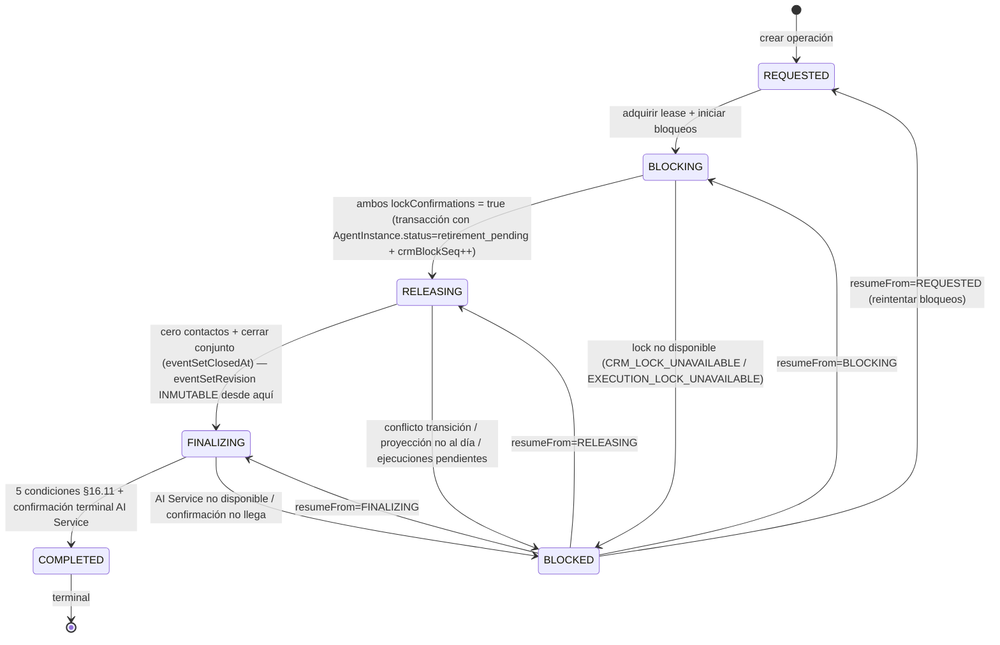

# WAB-79 — Especificación Física de `RetirementOperation`

> **Estado:** Plan / Análisis — No modificar código ni documentos canónicos.
> **Fuente canónica:** `waby-docs/projects/agents-multitenant/design/wab-79-dominio-ownership-persistencia.md` §16.4–§16.14
> **Proyecto de implementación:** CRM (`F:\ElemenSoft\crm`)
> **Fecha:** 18/11/2026
> **Versión:** 3.10 — Correcciones finales: búsqueda independiente EvAssigned (F-01), validación histórica prevCrmAssigned sin Contacto actual (F-02), atomicidad D-W79-15 para todas las transiciones (F-03), Outbox coherencia completa (F-04), criterios AC alineados (F-05)

---

## 1. Resumen Ejecutivo

Este informe cierra la especificación física implementable de `RetirementOperation` en MongoDB/Mongoose (CRM DB) derivando exclusivamente del contrato conceptual aprobado en §16.4–§16.14. No introduce campos, comportamientos ni decisiones no respaldadas por el documento canónico.

**Conclusión:** La especificación está **documentalmente consistente** (v3.10) con las correcciones finales aplicadas. Tres dependencias externas (C1, C2, C3) y decisiones físicas pendientes (P-01, P-04, P-06, P-08, P-09) bloquean la coordinación completa CRM ↔ AI Service y la ejecución de transacciones multidocumento.

| Dependencia | Qué Requiere | Bloquea | Responsable |
|---|---|---|---|
| **C1** | Topología MongoDB Atlas: replica set/sharded cluster con transacciones multidocumento; `Contacto`, `EvAssigned`, `Outbox`, `RetirementOperation`, `contact.assignment.record`, `AgentInstance` en misma DB; sesión Mongoose propagada | Todas las transacciones 🔴; **serialización efectiva Opción A** | Equipo Plataforma / DevOps |
| **C2** | Contrato de transporte Inbox/Outbox: routing keys, payloads `executionDrainConfirmation`, `finalizationConfirmation`, orden `retirement.finalize`, idempotencia por `retirementOperationId` | Coordinación CRM ↔ AI Service | Arquitectura / WAB-81 |
| **C3** | Ubicación física y atomicidad de `executionAdmission` (bloqueo admisión ejecuciones) | Doble bloqueo (§16.2), drenaje (§16.12), finalización (§16.11) | Arquitectura / WAB-79/WAB-81 |

**Decisiones físicas pendientes (no bloquean schema local pero sí implementación completa):**

| Decisión | Qué Resuelve | Bloquea |
|---|---|---|
| **P-01** | Identidad física Outbox (clave, índice, retención) | Schema Outbox aprobado; Outbox genérico en §5.5/§7.3 |
| **P-02** | Representación física `retirementOperationId` en envelope/payload | Correlación retiro en Outbox/Inbox |
| **P-03** | Contrato físico Inbox (schema, cursor causal, deduplicación) | Atomicidad §16.9 física |
| **P-04** | Alcance `previousEvAssignedId` (primera transición, absent/null) | Causalidad §16.9 física |
| **P-06** | Retención/purga por contexto Outbox/Inbox | Políticas de ciclo de vida |
| **P-08** | Inicialización física `leaseGeneration` (absent vs zero) | **Schema `ProcessingLease` corregido en v3.9** |
| **P-09** | Envelope/transporte RabbitMQ por contexto Outbox | Confirmación broker, ACK consumidor |

**Componentes implementables independientemente de C1–C3 y P-01/P-04/P-06/P-09 (solo schema y validaciones locales):**
- Modelo `RetirementOperation` + índices (schema, colección, validaciones)
- Operaciones de lease (adquisición, renovación, recuperación, liberación) + máquina de estados
- Máquina de estados y transiciones locales (sin transacciones multidocumento)
- Colección `retirement_confirmations` + índices + idempotencia
- Validaciones de integridad a nivel aplicación
- Colección `contact.assignment.record` + índice único parcial (H1)
- **Campo `crmBlockSeq` en `AgentInstance` (schema local — PROPUESTO, no implementado en código actual)**

**Componentes que requieren C1 (transacciones multidocumento y sesión compartida):**
- Serialización efectiva Opción A (CAS sobre `AgentInstance.crmBlockSeq` concurrente)
- Transacciones Contacto+EvAssigned+contact.assignment.record+Outbox+RetirementOperation (🔴)
- Cierre conjunto (releasing→finalizing) con lease
- Confirmación bloqueo CRM/Execution (lockConfirmations) con transición a `releasing`
- Integración AssignmentWriter completa
- Recuperación operación abandonada (consultas a autoridades)

**Componentes bloqueados por C2, C3:**
- Coordinación CRM ↔ AI Service (`executionDrainConfirmation`, `finalizationConfirmation`, cursor causal)
- Doble bloqueo, drenaje, finalización (`executionAdmission`)

---

## 2. Matriz de Trazabilidad Contractual

Extraída de §16.4–§16.14. Cada fila vincula un elemento contractual a su sección de origen, obligatoriedad, tipo lógico, relaciones, implicancias de concurrencia y estado de concreción física.

| # | Elemento Contractual | Sección Origen | Obligatoriedad | Tipo Lógico | Relaciones / Dependencias | Implicancias Concurrencia | Estado Físico |
|---|---|---|---|---|---|---|---|
| 1 | `retirementOperationId` (`_id`) | §16.4, §16.6 | Obligatorio | String/UUID | PK de la operación; clave de idempotencia global | Inmutable; creación idempotente por este ID | **Definido** |
| 2 | `workspaceId` | §16.4 | Obligatorio | String (Ref<Workspace>) | Ámbito de tenancy; valida cross-tenant | Inmutable tras creación | **Definido** |
| 3 | `agentInstanceId` | §16.4 | Obligatorio | String (Ref<AgentInstance>) | Instancia retirada; índice único parcial por agente no terminal | Inmutable tras creación | **Definido** |
| 4 | `actor` (`actorType`, `actorRef`) | §16.4 | Obligatorio | `ActorType` + String | Compatible con `EvAssigned.actorType/actorRef` | Inmutable; auditoría | **Definido** |
| 5 | `strategy` (`type`, `destinationId`) | §16.3, §16.4 | Obligatorio | Enum (`unassign` \| `reassign_user` \| `reassign_agent`) + String (Ref<User\|AgentInstance>) | Destino validado al inicio; inmutable | Inmutable; no auto-reasignación | **Definido** |
| 6 | `status` | §16.5 | Obligatorio | Enum (`requested` \| `blocking` \| `releasing` \| `finalizing` \| `blocked` \| `completed`) | Máquina de estados §16.5; transiciones controladas | Transiciones atómicas con CAS/lease | **Definido** |
| 7 | `resumeFrom` | §16.5, §16.6 | Obligatorio en `blocked` | Enum (etapa de recuperación) | Indica desde qué etapa reanudar tras `blocked` | Persistido en cada transición a `blocked` | **Definido** |
| 8 | `blockedReason` | §16.5 | Obligatorio en `blocked` | Código estable + detalles opcionales | Códigos: `CRM_LOCK_UNAVAILABLE`, `EXECUTION_LOCK_UNAVAILABLE`, `DESTINATION_INVALID`, `CONTACT_TRANSITION_CONFLICT`, `PROJECTION_NOT_CAUGHT_UP`, `PENDING_EXECUTIONS` | Diagnóstico; no altera flujo | **Definido** |
| 9 | `lockConfirmations` | §16.4, §16.2 | Obligatorio | Objeto anidado `{ crm: { confirmed: boolean, confirmedAt: Date }, execution: { confirmed: boolean, confirmedAt: Date, admissionBlockedAt: Date } }` | Confirmaciones durables de ambas autoridades | Escritura atómica por cada autoridad; idempotente por `retirementOperationId` | **Corregido v2.0** |
| 10 | `executionDrainConfirmation` | §16.4, §16.12 | Obligatorio antes de `finalizing` | Objeto `{ confirmed: boolean, confirmedAt: Date, admissionBlockedAt: Date }` | Confirmación inmutable de AI Service; ligada a `retirementOperationId` y `admissionBlockedAt` | Idempotente; duplicados misma operación/bloqueo se ignoran | **Definido** |
| 11 | `finalizationConfirmation` | §16.4, §16.13 | Obligatorio para `completed` | Objeto `{ confirmed: boolean, confirmedAt: Date }` | Confirmación terminal durable de AI Service para orden de finalización | Idempotente; valida bloqueo y drenaje corresponden a la operación | **Definido** |
| 12 | `processing` (`leaseOwner`, `leaseUntil`, `leaseGeneration`) | §16.4, §16.6 | Obligatorio | Objeto `{ leaseOwner: string|null, leaseUntil: Date|null, leaseGeneration: number }` | Lease/fencing del worker; generación incrementa en cada adquisición efectiva | **Crítico**: toda escritura del worker valida owner, generación y vigencia; worker obsoleto no avanza | **Corregido v2.0, v3.0 (B4), v3.9 (P-08)** |
| 13 | `eventSetRevision` | §16.4, §16.9, §16.10 | Obligatorio | Integer (monotónico) | Incrementado en cada transición que saca contacto de A durante `releasing` (incluye externas) | **Atómico** con Contacto+EvAssigned+record+RetirementOperation en misma transacción; CAS valida revisión esperada | **Corregido v2.0, v3.0 (B2)** |
| 14 | `eventSetClosedAt` | §16.4, §16.10 | Obligatorio en `finalizing` | Date | Timestamp de cierre del conjunto esperado | Escritura atómica con validación `releasing` + lease + cero contactos | **Definido** |
| 15 | `lastProgressAt` | §16.4 | Opcional (informativo) | Date | Último progreso real del worker | No es fuente de verdad; solo observabilidad | **Definido** |
| 16 | `attempts` | §16.4 | Opcional (informativo) | Integer | Contador de reintentos del worker | No es fuente de verdad; solo observabilidad | **Definido** |
| 17 | `createdAt`, `updatedAt`, `completedAt` | §16.4 | Obligatorio | Date | Timestamps estándar | `completedAt` solo en terminal | **Definido** |
| 18 | Índice único parcial `agentInstanceId` para estados no terminales | §16.6 | Obligatorio | Índice | `requested`, `blocking`, `releasing`, `finalizing`, `blocked` | Impide operaciones concurrentes de retiro sobre misma instancia | **Definido** |
| 19 | Correlación `EvAssigned.retirementOperationId` | §16.8, §16.9 | Obligatorio | String (en EvAssigned) | Vincula cada transición de salida a la operación | Índice único parcial `{retirementOperationId:1, contacto:1}` en EvAssigned | **Definido** (requiere campo en EvAssigned) |
| 20 | `retirement_confirmations` colección | §16.9, §16.11 | Obligatorio | Colección independiente | `{ evAssignedId, retirementOperationId, confirmedAt }`; índices únicos | Idempotencia por `evAssignedId`; validación pertenencia a operación | **Completado v2.0** |
| 21 | `contact.assignment.record` colección | H1 (P-01 opción B) | Obligatorio | Colección independiente | Evidencia transaccional durable; `evAssignedId` top-level ObjectId; índice único parcial `{evAssignedId:1}` con filtro `{type:"contact.assignment.record"}` | Idempotencia por `evAssignedId`; derivación a `sync` en WAB-81/P-05 | **Corregido v3.0 (B1)** |
| 22 | **`AgentInstance.crmBlockSeq`** | **Opción A aprobada** | **Obligatorio** | **Integer (monotónico)** | **Recurso guardián compartido para serializar bloqueo CRM vs. asignaciones entrantes** | **CAS atómico: confirmación bloqueo CRM incrementa; asignación entrante incrementa y valida; rechaza si bloqueo confirmado** | **v3.10 — PROPUESTO en especificación; NO implementado en código actual** |

---

## 3. Schema Físico Propuesto — `RetirementOperation`

### 3.1 Colección y Nombre del Modelo

| Aspecto | Decisión | Justificación Contractual |
|---|---|---|
| **Colección MongoDB** | `retirement_operations` | Singular lógico, plural físico; consistente con `agent_instances`, `skill_configurations` |
| **Modelo Mongoose/Typegoose** | `RetirementOperation` | Clase PascalCase; exporta `RetirementOperationModel` |
| **Discriminador** | Ninguno | Entidad independiente; no hereda de `Evento` |

### 3.2 Definición Completa del Schema (Typegoose)

```typescript
// F:\ElemenSoft\crm\src\models\agent\RetirementOperation.model.ts
import {
  modelOptions,
  prop,
  index,
  getModelForClass,
  Severity,
  mongoose,
} from "@typegoose/typegoose";
import { Field, ObjectType, ID, registerEnumType } from "type-graphql";

// ============================================
// ENUMS (valores contractuales §16.5, §16.3)
// ============================================

export enum RetirementOperationStatus {
  REQUESTED = "requested",
  BLOCKING = "blocking",
  RELEASING = "releasing",
  FINALIZING = "finalizing",
  BLOCKED = "blocked",
  COMPLETED = "completed",
}

export enum RetirementStrategyType {
  UNASSIGN = "unassign",
  REASSIGN_USER = "reassign_user",
  REASSIGN_AGENT = "reassign_agent",
}

export enum BlockedReasonCode {
  CRM_LOCK_UNAVAILABLE = "CRM_LOCK_UNAVAILABLE",
  EXECUTION_LOCK_UNAVAILABLE = "EXECUTION_LOCK_UNAVAILABLE",
  DESTINATION_INVALID = "DESTINATION_INVALID",
  CONTACT_TRANSITION_CONFLICT = "CONTACT_TRANSITION_CONFLICT",
  PROJECTION_NOT_CAUGHT_UP = "PROJECTION_NOT_CAUGHT_UP",
  PENDING_EXECUTIONS = "PENDING_EXECUTIONS",
}

// Reutilizar ActorType de EvAssigned (compatibilidad §16.4)
import { ActorType } from "../events/EvAssigned.model";
registerEnumType(ActorType, { name: "ActorType" });
registerEnumType(RetirementOperationStatus, { name: "RetirementOperationStatus" });
registerEnumType(RetirementStrategyType, { name: "RetirementStrategyType" });
registerEnumType(BlockedReasonCode, { name: "BlockedReasonCode" });

// ============================================
// SUBDOCUMENTOS EMBEBIDOS
// ============================================

@modelOptions({ schemaOptions: { _id: false } })
export class ActorRef {
  @Field(() => ActorType)
  @prop({ required: true, enum: ActorType, type: () => String })
  actorType!: ActorType;

  @Field()
  @prop({ required: true, type: () => String })
  actorRef!: string;
}

@modelOptions({ schemaOptions: { _id: false } })
export class RetirementStrategy {
  @Field(() => RetirementStrategyType)
  @prop({ required: true, enum: RetirementStrategyType, type: () => String })
  type!: RetirementStrategyType;

  @Field({ nullable: true })
  @prop({ type: () => String })
  destinationId?: string; // User._id o AgentInstance._id según type
}

// CORRECCIÓN 1: Estructura anidada según contrato §16.4, §16.2
@modelOptions({ schemaOptions: { _id: false } })
export class CrmLockConfirmation {
  @Field()
  @prop({ required: true, default: false })
  confirmed!: boolean;

  @Field({ nullable: true })
  @prop({ type: () => Date })
  confirmedAt?: Date;
}

@modelOptions({ schemaOptions: { _id: false } })
export class ExecutionLockConfirmation {
  @Field()
  @prop({ required: true, default: false })
  confirmed!: boolean;

  @Field({ nullable: true })
  @prop({ type: () => Date })
  confirmedAt?: Date;

  @Field({ nullable: true })
  @prop({ type: () => Date })
  admissionBlockedAt?: Date; // §16.7, §16.12 — inmutable tras primera confirmación
}

@modelOptions({ schemaOptions: { _id: false } })
export class LockConfirmations {
  @Field(() => CrmLockConfirmation)
  @prop({ required: true, _id: false, default: {} })
  crm!: CrmLockConfirmation;

  @Field(() => ExecutionLockConfirmation)
  @prop({ required: true, _id: false, default: {} })
  execution!: ExecutionLockConfirmation;
}

@modelOptions({ schemaOptions: { _id: false } })
export class ExecutionDrainConfirmation {
  @Field()
  @prop({ required: true, default: false })
  confirmed!: boolean;

  @Field({ nullable: true })
  @prop({ type: () => Date })
  confirmedAt?: Date;

  @Field({ nullable: true })
  @prop({ type: () => Date })
  admissionBlockedAt?: Date; // debe coincidir con lockConfirmations.execution.admissionBlockedAt
}

@modelOptions({ schemaOptions: { _id: false } })
export class FinalizationConfirmation {
  @Field()
  @prop({ required: true, default: false })
  confirmed!: boolean;

  @Field({ nullable: true })
  @prop({ type: () => Date })
  confirmedAt?: Date;
}

// CORRECCIÓN 2, B4, P-08: Lease/fencing con estado inicial nulo manejado correctamente;
// leaseGeneration SIN default Mongoose — inicialización explícita requerida (absent ≠ zero)
@modelOptions({ schemaOptions: { _id: false } })
export class ProcessingLease {
  @Field({ nullable: true })
  @prop({ type: () => String })
  leaseOwner?: string | null; // worker identifier

  @Field({ nullable: true })
  @prop({ type: () => Date })
  leaseUntil?: Date | null;

  @Field({ nullable: true }) // nullable para consistencia GraphQL; absent ≠ zero
  @prop({ required: true, type: () => Number }) // SIN default: 0 — P-08 exige escritura explícita de 0
  leaseGeneration!: number; // incrementa en cada adquisición EFECTIVA (primera + recuperaciones)
}

// ============================================
// MODELO PRINCIPAL
// ============================================

@ObjectType({ description: "Operación coordinada de retiro de AgentInstance" })
@modelOptions({
  schemaOptions: {
    timestamps: true,
    collection: "retirement_operations",
    versionKey: false,
    _id: false, // _id será String/UUID provisto por la aplicación
  },
  options: { allowMixed: Severity.ALLOW },
})
// ÍNDICES — ver §4 para justificación completa
@index({ agentInstanceId: 1 }, { unique: true, partialFilterExpression: { status: { $in: ["requested", "blocking", "releasing", "finalizing", "blocked"] } } })
@index({ workspaceId: 1, status: 1 })
@index({ eventSetRevision: 1 })
@index({ "processing.leaseOwner": 1, "processing.leaseUntil": 1 })
export class RetirementOperation {
  @Field(() => ID)
  @prop({ required: true, type: () => String })
  _id!: string; // retirementOperationId — UUID generado por aplicación

  @Field()
  @prop({ required: true, type: () => String })
  workspaceId!: string; // Ref<Workspace> — ámbito de tenancy

  @Field()
  @prop({ required: true, type: () => String })
  agentInstanceId!: string; // Ref<AgentInstance> — instancia retirada

  @Field(() => ActorRef)
  @prop({ required: true, _id: false })
  actor!: ActorRef; // quien solicitó el retiro

  @Field(() => RetirementStrategy)
  @prop({ required: true, _id: false })
  strategy!: RetirementStrategy; // inmutable tras creación

  @Field(() => RetirementOperationStatus, { defaultValue: RetirementOperationStatus.REQUESTED })
  @prop({
    required: true,
    enum: RetirementOperationStatus,
    default: RetirementOperationStatus.REQUESTED,
    type: () => String,
  })
  status!: RetirementOperationStatus;

  @Field({ nullable: true })
  @prop({ enum: RetirementOperationStatus, type: () => String })
  resumeFrom?: RetirementOperationStatus; // obligatorio cuando status=BLOCKED

  @Field(() => BlockedReasonCode, { nullable: true })
  @prop({ enum: BlockedReasonCode, type: () => String })
  blockedReason?: BlockedReasonCode; // obligatorio cuando status=BLOCKED

  @Field({ nullable: true })
  @prop({ type: () => String })
  blockedReasonDetail?: string; // detalles opcionales

  @Field(() => LockConfirmations)
  @prop({ required: true, _id: false, default: {} })
  lockConfirmations!: LockConfirmations;

  @Field(() => ExecutionDrainConfirmation, { nullable: true })
  @prop({ _id: false })
  executionDrainConfirmation?: ExecutionDrainConfirmation; // presente tras confirmación AI Service

  @Field(() => FinalizationConfirmation, { nullable: true })
  @prop({ _id: false })
  finalizationConfirmation?: FinalizationConfirmation; // presente tras confirmación terminal AI Service

  @Field(() => ProcessingLease)
  @prop({ required: true, _id: false, default: {} })
  processing!: ProcessingLease;

  @Field({ defaultValue: 0 })
  @prop({ required: true, default: 0, type: () => Number })
  eventSetRevision!: number; // monotónico; §16.9, §16.10

  @Field({ nullable: true })
  @prop({ type: () => Date })
  eventSetClosedAt?: Date; // §16.10 — solo en finalizing/completed

  @Field({ nullable: true })
  @prop({ type: () => Date })
  lastProgressAt?: Date; // informativo

  @Field({ defaultValue: 0 })
  @prop({ required: true, default: 0, type: () => Number })
  attempts!: number; // informativo

  // timestamps automáticos (createdAt, updatedAt) + completedAt manual
  @Field({ nullable: true })
  @prop({ type: () => Date })
  completedAt?: Date; // solo cuando status=COMPLETED
}

export const RetirementOperationModel = getModelForClass(RetirementOperation);
```

### 3.3 Schema Físico — Colección `retirement_confirmations` (v2.0)

```typescript
// F:\ElemenSoft\crm\src\models\agent\RetirementConfirmation.model.ts
import {
  modelOptions,
  prop,
  index,
  getModelForClass,
  Severity,
} from "@typegoose/typegoose";
import { Field, ObjectType, ID, registerEnumType } from "type-graphql";

@ObjectType({ description: "Confirmación durable de aplicación de EvAssigned por AI Service" })
@modelOptions({
  schemaOptions: {
    timestamps: true,
    collection: "retirement_confirmations",
    versionKey: false,
    _id: false,
  },
  options: { allowMixed: Severity.ALLOW },
})
// Índices — ver §4.1 filas 6 y 7
@index({ evAssignedId: 1 }, { unique: true }) // idempotencia por evento
@index({ retirementOperationId: 1, evAssignedId: 1 }) // consulta por operación
export class RetirementConfirmation {
  @Field(() => ID)
  @prop({ required: true, type: () => String })
  _id!: string; // UUID generado por aplicación (o evAssignedId como _id)

  @Field()
  @prop({ required: true, type: () => String, index: true })
  evAssignedId!: string; // identidad del EvAssigned confirmado — clave de idempotencia §16.9

  @Field()
  @prop({ required: true, type: () => String, index: true })
  retirementOperationId!: string; // pertenencia a la operación

  @Field()
  @prop({ required: true, type: () => Date, default: Date.now })
  confirmedAt!: Date; // momento de confirmación durable por AI Service
}

export const RetirementConfirmationModel = getModelForClass(RetirementConfirmation);
```

**Validaciones a nivel aplicación (no en schema):**
- Al insertar: verificar que `evAssignedId` corresponde a un `EvAssigned` existente con `retirementOperationId` coincidente
- Rechazar si `evAssignedId` ya existe (duplicado → idempotente, ignorar)
- Rechazar si `retirementOperationId` no coincide con el `EvAssigned` referenciado (inconsistencia)
- Rechazar si el `EvAssigned` no pertenece al conjunto esperado (ver §16.11 condición 5)

### 3.4 Schema Físico — Colección `contact.assignment.record` (B1, H1)

```typescript
// F:\ElemenSoft\crm\src\models\assignments\ContactAssignmentRecord.model.ts
import {
  modelOptions,
  prop,
  index,
  getModelForClass,
  Severity,
  mongoose,
} from "@typegoose/typegoose";
import { Field, ObjectType, ID, registerEnumType } from "type-graphql";
import { ActorType } from "../events/EvAssigned.model";
import { AssignedType } from "../events/EvAssigned.model";
import { OperationType } from "../events/EvAssigned.model";

registerEnumType(ActorType, { name: "ActorType" });
registerEnumType(AssignedType, { name: "AssignedType" });
registerEnumType(OperationType, { name: "OperationType" });

@ObjectType({ description: "Evidencia transaccional durable de transición de asignación (H1/P-01 opción B)" })
@modelOptions({
  schemaOptions: {
    timestamps: true,
    collection: "contact_assignment_records",
    versionKey: false,
    _id: false,
  },
  options: { allowMixed: Severity.ALLOW },
})
// Índice único parcial H1: { evAssignedId: 1 } con partialFilterExpression: { evAssignedId: { $type: "objectId" }, type: "contact.assignment.record" }
@index(
  { evAssignedId: 1 },
  { unique: true, partialFilterExpression: { evAssignedId: { $type: "objectId" }, type: "contact.assignment.record" } }
)
@index({ contactId: 1, createdAt: -1 })
@index({ retirementOperationId: 1, contactId: 1 })
export class ContactAssignmentRecord {
  @Field(() => ID)
  @prop({ required: true, type: () => String })
  _id!: string; // UUID generado por aplicación (String/UUID, NO ObjectId)

  @Field()
  @prop({ required: true, type: () => String })
  type!: string; // "contact.assignment.record" — discriminador lógico

  @Field()
  @prop({ required: true, type: () => String })
  contactId!: string; // Contacto afectado

  @Field()
  @prop({ required: true, type: () => String })
  workspaceId!: string; // Workspace del contacto

  @Field(() => AssignedType)
  @prop({ required: true, enum: AssignedType, type: () => String })
  prevAssignedType!: AssignedType;

  @Field({ nullable: true })
  @prop({ type: () => String })
  prevAssignedRef?: string;

  @Field(() => AssignedType)
  @prop({ required: true, enum: AssignedType, type: () => String })
  newAssignedType!: AssignedType;

  @Field({ nullable: true })
  @prop({ type: () => String })
  newAssignedRef?: string;

  @Field(() => ActorType)
  @prop({ required: true, enum: ActorType, type: () => String })
  actorType!: ActorType;

  @Field()
  @prop({ required: true, type: () => String })
  actorRef!: string;

  @Field(() => OperationType)
  @prop({ required: true, enum: OperationType, type: () => String })
  operationType!: OperationType;

  @Field({ nullable: true })
  @prop({ type: () => String })
  reason?: string;

  // CORRECCIÓN B1 / H1: evAssignedId como ObjectId top-level (BSON ObjectId)
  @Field()
  @prop({ required: true, type: () => mongoose.Types.ObjectId })
  evAssignedId!: mongoose.Types.ObjectId; // identidad del EvAssigned correlacionado — clave de idempotencia

  @Field({ nullable: true })
  @prop({ type: () => String })
  retirementOperationId?: string; // correlación con retiro, si aplica (opcional; presente en transiciones de retiro)

  @Field({ nullable: true })
  @prop({ type: () => String })
  derivedFromRecordId?: string; // para trazabilidad record → sync (WAB-81/P-05)
}

export const ContactAssignmentRecordModel = getModelForClass(ContactAssignmentRecord);
```

**Notas contractuales (H1):**
- `evAssignedId` es **BSON ObjectId** top-level (no string)
- Índice único parcial: `{ evAssignedId: 1 }` con `partialFilterExpression: { evAssignedId: { $type: "objectId" }, type: "contact.assignment.record" }`
- `contact.assignment.sync` tiene `_id` propia, independiente; su payload incluye `derivedFrom` referenciando `record.evAssignedId` como string
- La derivación `record → sync` pertenece a **WAB-81/P-05**, no a Unidad 2

### 3.5 Campo `crmBlockSeq` en `AgentInstance` — Opción A (v3.10)

```typescript
// AÑADIR a F:\ElemenSoft\crm\src\models\agent\AgentInstance.model.ts
// (línea ~100, antes del cierre de la clase)

  /** Campo técnico interno — NO expuesto en GraphQL. Serializa operaciones concurrentes de bloqueo CRM vs. asignaciones entrantes. */
  @prop({ default: 0 })
  crmBlockSeq!: number;
```

**Nota importante — Estado v3.10:** El campo `crmBlockSeq` forma parte de la especificación de la Opción A para serialización de retiro. **No forma parte del alcance de WAB-94/A1**, que excluye lifecycle, retiro y asignaciones. La ausencia actual de este campo en `AgentInstance.model.ts` es una **diferencia entre especificación y código actual**, no una implementación realizada. Su implementación requiere delimitación y autorización propias, posteriores a WAB-94/A1. No modificar código de producción en esta tarea.

---

## 4. Índices y Restricciones

### 4.1 Índices Propuestos

| # | Colección | Campos y Orden | Tipo | Partial Filter Expression | Justificación | Invariante Protegida |
|---|---|---|---|---|---|---|
| 1 | `retirement_operations` | `{ agentInstanceId: 1 }` | **Único parcial** | `{ status: { $in: ["requested", "blocking", "releasing", "finalizing", "blocked"] } }` | §16.6: una sola operación no terminal por AgentInstance | Unicidad de retiro activo; creación idempotente por `_id` resuelve carreras |
| 2 | `retirement_operations` | `{ workspaceId: 1, status: 1 }` | Compuesto simple | — | Consultar operaciones por workspace y estado | — |
| 3 | `retirement_operations` | `{ eventSetRevision: 1 }` | Simple | — | Consultas de progreso y verificación de cierre | — |
| 4 | `retirement_operations` | `{ "processing.leaseOwner": 1, "processing.leaseUntil": 1 }` | Compuesto | — | Recuperar operaciones con lease vencido (worker caído) | Lease/fencing §16.6 |
| 5 | `eventos` (EvAssigned) | `{ retirementOperationId: 1, contacto: 1 }` | **Único parcial** | `{ retirementOperationId: { $exists: true } }` | §16.8: máximo un EvAssigned correlacionado por operación/contacto | Idempotencia de transición; evita duplicados en carrera |
| 6 | `retirement_confirmations` | `{ evAssignedId: 1 }` | **Único** | — | §16.9: idempotencia de confirmación por evento | Unicidad de confirmación; duplicados misma operación se ignoran |
| 7 | `retirement_confirmations` | `{ retirementOperationId: 1, evAssignedId: 1 }` | Compuesto | — | Consultar confirmaciones de una operación; validar correspondencia completa §16.11 | Correspondencia exacta eventos esperados ↔ confirmaciones |
| 8 | `contact_assignment_records` | `{ evAssignedId: 1 }` | **Único parcial** | `{ evAssignedId: { $type: "objectId" }, type: "contact.assignment.record" }` | H1 (P-01 opción B): idempotencia de transición por `evAssignedId` | Unicidad de evidencia transaccional; derivación a sync en WAB-81 |
| 9 | `contact_assignment_records` | `{ contactId: 1, createdAt: -1 }` | Compuesto | — | Historial de asignaciones por contacto | — |
| 10 | `contact_assignment_records` | `{ retirementOperationId: 1, contactId: 1 }` | Compuesto | — | Consultar transiciones de un retiro | — |
| 11 | `agent_instances` | (existente) | — | — | El campo `crmBlockSeq` no requiere índice adicional; el CAS usa `_id` + valor esperado | Serialización Opción A |

### 4.2 Restricciones de Integridad (Nivel Aplicación)

| Restricción | Validación | Momento |
|---|---|---|
| `workspaceId` pertenece a la Organización del contexto autenticado | Consulta `Workspace` + validación `Organization` | Creación y cualquier actualización que cambie `workspaceId` (no debería ocurrir) |
| `agentInstanceId` existe y su `workspaceId` coincide | Consulta `AgentInstance` | Creación |
| `strategy.destinationId` existe y pertenece al mismo `workspaceId` | Consulta `UsOrgsWorks` o `AgentInstance` según `strategy.type` | Creación (validación de destino §16.3) |
| `strategy.type === REASSIGN_AGENT` → `destinationId` ≠ `agentInstanceId` | Comparación simple | Creación (no auto-reasignación §16.3) |
| Transiciones de `status` solo según máquina de estados §16.5 | Validación en servicio antes de CAS | Cada operación de cambio de estado |
| `resumeFrom` obligatorio si `status === BLOCKED` | Validación en servicio | Transición a `BLOCKED` |
| `blockedReason` obligatorio si `status === BLOCKED` | Validación en servicio | Transición a `BLOCKED` |
| `eventSetRevision` solo incrementa (monotónico) | CAS en transacción | Cada transición en `releasing` |
| `eventSetClosedAt` solo se escribe en transición `releasing → finalizing` | Validación en servicio | Transición a `finalizing` |
| `completedAt` solo se escribe en transición a `COMPLETED` | Validación en servicio | Transición a `COMPLETED` |
| `executionDrainConfirmation` inmutable tras primera escritura | Validación en servicio (rechazar si ya `confirmed=true`) | Recepción confirmación AI Service |
| `finalizationConfirmation` inmutable tras primera escritura | Validación en servicio | Recepción confirmación terminal AI Service |
| `lockConfirmations.execution.admissionBlockedAt` inmutable tras primera confirmación | Validación en servicio | Recepción confirmación bloqueo Execution |
| `contact.assignment.record.evAssignedId` tipo ObjectId | Validación en servicio | Inserción record |
| **`crmBlockSeq` solo incrementa (monotónico)** | **CAS en transacción** | **Confirmación bloqueo CRM y asignación entrante (Opción A)** |

---

## 5. Operaciones Persistentes y Contratos CAS

Cada operación define: precondiciones, escritura atómica, filtro CAS, campos modificados, resultado esperado, errores y conflictos. Las operaciones que **deben ejecutarse en transacción MongoDB** junto con `Contacto`, `EvAssigned`, `contact.assignment.record`, `Outbox` y `RetirementOperation` según D-W79-15, H1 y §16.8–§16.10 están marcadas con 🔴 **TRANSACCIÓN**.

**REGLA GENERAL (CORRECCIÓN 4, B4):** Toda escritura CAS cuya coincidencia sea obligatoria **debe comprobar su resultado**. Si `findOneAndUpdate`/`updateOne` retorna `null` o `matchedCount === 0`:
- Lanzar el conflicto correspondiente (`CONFLICT_*`)
- Abortar la transacción cuando corresponda
- No permitir que se confirmen escrituras parciales
- No interpretar una actualización fallida como operación exitosa
- Prestar especial atención al incremento de `eventSetRevision`

### 5.1 Crear Operación de Retiro

| Aspecto | Definición |
|---|---|
| **Precondiciones** | • `AgentInstance` existe, `status ∈ {active, suspended}`<br>• No existe `RetirementOperation` no terminal para ese `agentInstanceId` (índice único parcial)<br>• `workspaceId` válido y pertenece a Organización autenticada<br>• `strategy.destinationId` validado (existe, mismo workspace, no auto-reasignación) |
| **Escritura** | `insertOne` con `_id` generado (UUID), `status=requested`, `lockConfirmations={crm:{confirmed:false}, execution:{confirmed:false}}`, `processing={leaseGeneration:0, leaseOwner:null, leaseUntil:null}`, `eventSetRevision=0`, `attempts=0` |
| **CAS / Unicidad** | Índice único parcial en `agentInstanceId` para estados no terminales — falla con `E11000` si ya existe |
| **Campos modificados** | Todos (creación) |
| **Resultado esperado** | Documento creado; `retirementOperationId` devuelto |
| **Errores** | `CONFLICT_OPERATION_EXISTS` (índice único), `VALIDATION_ERROR` (destino inválido), `NOT_FOUND` (AgentInstance) |
| **Transacción** | No (operación única) |
| **Idempotencia** | Por `_id` — si el cliente reenvía mismo `retirementOperationId`, `insertOne` falla por `_id` duplicado; el caller puede consultar la existente |

### 5.2 Iniciar Bloqueo (Requested → Blocking)

| Aspecto | Definición |
|---|---|
| **Precondiciones** | • `status = requested`<br>• Lease adquirido (ver 5.3) |
| **Escritura** | `findOneAndUpdate` con filtro `{ _id, status: "requested" }`, `$set: { status: "blocking", updatedAt: now }` |
| **CAS** | Filtro incluye `status: "requested"` — evita transición si ya cambió |
| **Verificación resultado** | Si retorna `null` → lanzar `CONFLICT_STATUS_CHANGED` |
| **Campos modificados** | `status`, `updatedAt` |
| **Resultado** | Documento actualizado |
| **Transacción** | No (solo RetirementOperation) |

### 5.3 Adquirir / Renovar / Liberar / Recuperar Lease (CORRECCIÓN 2, B4, P-08)

El estado inicial del documento tiene `leaseOwner: null`, `leaseUntil: null`, `leaseGeneration: 0` **escrito explícitamente al crear la operación** (no default Mongoose). Los filtros CAS deben manejar correctamente esta situación y validar **generación** en toda operación dependiente del lease.

| Operación | Filtro CAS | Actualización Atómica | Cuándo |
|---|---|---|---|
| **Primera adquisición** (primer worker) | `{ _id, $or: [ { "processing.leaseOwner": null, "processing.leaseUntil": null }, { "processing.leaseUntil": { $lt: now } } ], status: { $in: ["requested", "blocking", "releasing", "finalizing"] } }` | `$set: { "processing.leaseOwner": workerId, "processing.leaseUntil": now + TTL }, $inc: { "processing.leaseGeneration": 1 }` | Inicio `requested` (worker retiro), `blocking`, `releasing`, `finalizing` |
| **Renovación** (mismo worker, lease vigente) | `{ _id, "processing.leaseOwner": workerId, "processing.leaseGeneration": currentGen, "processing.leaseUntil": { $gt: now } }` | `$set: { "processing.leaseUntil": now + TTL }` (generación **no** cambia) | Heartbeat periódico |
| **Liberación** (fin trabajo voluntario) | `{ _id, "processing.leaseOwner": workerId, "processing.leaseGeneration": currentGen }` | `$set: { "processing.leaseOwner": null, "processing.leaseUntil": null }` (generación **no** cambia) | Fin de etapa, error, o `blocked` |
| **Recuperación tras expiración** (otro worker) | `{ _id, "processing.leaseUntil": { $lt: now }, status: { $in: ["requested", "blocking", "releasing", "finalizing"] } }` | `$set: { "processing.leaseOwner": newWorkerId, "processing.leaseUntil": now + TTL }, $inc: { "processing.leaseGeneration": 1 }` | Worker caído; §16.6 |
| **Reanudación desde `blocked`** | `{ _id, status: "blocked", resumeFrom: <valor_específico_de_la_operación>, $or: [ { "processing.leaseOwner": null, "processing.leaseUntil": null }, { "processing.leaseUntil": { $lt: now } } ] }` | `$set: { "processing.leaseOwner": workerId, "processing.leaseUntil": now + TTL }, $inc: { "processing.leaseGeneration": 1 }` | Reanudación desde `blocked` con `resumeFrom` válido |

**Notas críticas (B4, P-08):**
- La primera adquisición **exige `leaseOwner: null` Y `leaseUntil: null` simultáneamente** (estado inicial coherente), **no** solo uno de los dos. Un documento con `leaseOwner: null` pero `leaseUntil` futuro es inconsistente y **no** permite adquisición.
- Un lease **vigente de otro worker** (owner ≠ null, leaseUntil > now) **nunca** puede ser apropiado por la ruta de reanudación o adquisición. El filtro exige lease nulo o vencido.
- `leaseGeneration` **solo incrementa** en adquisición efectiva (primera vez o recuperación tras expiración), **no** en renovación ni liberación.
- **Toda escritura posterior del worker** (cambio de estado, progreso, `eventSetRevision`) **debe incluir** en su filtro CAS: `"processing.leaseOwner": workerId, "processing.leaseGeneration": currentGen, "processing.leaseUntil": { $gt: now }`
- Worker obsoleto (generación vieja o lease vencido) **no puede** avanzar estado ni escribir progreso.
- **La liberación valida `leaseGeneration`** — un worker con generación anterior no puede liberar una adquisición posterior.
- **Verificación obligatoria:** Cada `findOneAndUpdate` de lease debe comprobar `matchedCount === 1` (o documento retornado no null). Si falla → el lease ya no es válido; el worker debe re-leer y decidir.
- **Estados terminales:** No se permite adquirir/renovar lease si `status ∈ {completed, blocked}` (salvo reanudación desde `blocked` con `resumeFrom`).
- **Relación con `requested`:** El worker del retiro adquiere el lease **en estado `requested`** antes de iniciar la transición `requested → blocking`. Esto resuelve el ciclo §5.2/§5.3.
- **`resumeFrom` path correcto:** El campo `resumeFrom` está en el **nivel superior** del documento `RetirementOperation` (no en `processing.resumeFrom`). El filtro de reanudación usa `resumeFrom` en el nivel raíz del documento con el **valor específico** de la operación (no array).
- **Lease vigente de otro worker no apropiable:** Un lease vigente perteneciente a otro worker (owner ≠ null, leaseUntil > now) **nunca** puede ser apropiado por la ruta de reanudación o adquisición. El filtro exige lease nulo o vencido.
- **P-08 — Inicialización `leaseGeneration`:** El valor `0` se escribe **explícitamente** al crear la operación (`insertOne` con `processing.leaseGeneration: 0`). **No se usa `default: 0` en Mongoose** — `absent ≠ zero`. La distinción es contractual (§16.6, E9/E10).

### 5.4 Confirmar Bloqueo CRM / Execution (Blocking) — Opción A

| Autoridad | Precondición | Escritura Atómica | Idempotencia | Verificación Resultado |
|---|---|---|---|---|
| **CRM** (asignaciones) | `lockConfirmations.crm.confirmed = false` | **Transacción local:**<br>1. `$set: { "lockConfirmations.crm.confirmed": true, "lockConfirmations.crm.confirmedAt": now }` en `RetirementOperation`<br>2. `$inc: { crmBlockSeq: 1 }` en `AgentInstance` (mismo `_id = agentInstanceId`) | Por `retirementOperationId` — reintentar misma operación es seguro | `matchedCount === 1` en **ambos** documentos |
| **Execution Service** (admisión) | `lockConfirmations.execution.confirmed = false` | `$set: { "lockConfirmations.execution.confirmed": true, "lockConfirmations.execution.confirmedAt": now, "lockConfirmations.execution.admissionBlockedAt": now }` | Idem; `admissionBlockedAt` inmutable tras primera confirmación | `matchedCount === 1` o documento retornado |

**Transición a `releasing`:** Cuando **ambas** confirmaciones son `true`, una operación atómica (puede ser la segunda confirmación) cambia `status: "releasing"` y `AgentInstance.status: "retirement_pending"` **en la misma transacción** que persiste la confirmación (ver 5.10). Esta transición **requiere C1** (transacción multidocumento).

**Serialización Opción A:** La confirmación del bloqueo CRM incrementa `AgentInstance.crmBlockSeq` atómicamente. Cualquier asignación entrante debe incrementar y validar `crmBlockSeq` en su propio CAS (ver §7.2). **Si el bloqueo CRM ya está confirmado, la asignación entrante DEBE RECHAZARSE, incluso si su CAS sobre `crmBlockSeq` resulta exitoso.**

### 5.5 Transición de Contacto Durante `releasing` — 🔴 **TRANSACCIÓN** (B1, B2, B3, B5)

> Ejecutada tanto por el worker de RetirementOperation como por AssignmentWriter (transiciones externas). Misma estructura transaccional, distinta procedencia del actor.
>
> **B2:** `eventSetRevision` solo se incrementa durante `releasing`. En `finalizing` el conjunto es inmutable.
>
> **B1:** La transición persiste `contact.assignment.record` (no `sync`) como evidencia transaccional durable. El **Outbox genérico** requerido por D-W79-15 se inserta en la misma transacción. La derivación `record → contact.assignment.sync` pertenece a WAB-81/P-05.
>
> **B5:** El orden de idempotencia: buscar transición existente por **clave lógica** (`retirementOperationId` + `contactId`) **antes** de mutar Contacto.

**Transacción por contacto (Contacto + EvAssigned + contact.assignment.record + Outbox genérico + RetirementOperation):**

| Paso | Operación | Filtro CAS / Validación |
|---|---|---|
| 1 | **Identificar transición lógica** por clave idempotente: `retirementOperationId` + `contactId` | Consultar `contact.assignment.record` por `{ retirementOperationId, contactId }` y `EvAssigned` por `{ retirementOperationId, contacto: contactId }` — **antes** de mutar Contacto |
| 2 | Si existe evidencia → **verificar coherencia completa** (Contacto, EvAssigned, record, `eventSetRevision`, Outbox) y **reutilizar sin mutar** | Leer Contacto actual; comparar `assignedType`, `ref_agent_assigned`, `ref_ev_assigned` con lo esperado; si coherente → saltar a paso 11 (Outbox **no** se vuelve a insertar) |
| 3 | **Generar identidad estable** `newEvId` (ObjectId) **fuera del callback transaccional** | `newEvId = new ObjectId()` — mismo para todos los reintentos del callback |
| 4 | Leer `Contacto` actual (en transacción) | `{ _id: contactId, ref_agent_assigned: agentInstanceId, ref_ev_assigned: expectedEvId }` |
| 5 | Validar que sigue asignado a A | `assignedType === "agent" && ref_agent_assigned === agentInstanceId` |
| 6 | Crear `EvAssigned` con `retirementOperationId` | `insertOne` con `_id: newEvId`, `retirementOperationId`, actor/operationType reales — índice único parcial protege duplicados |
| 7 | Crear `contact.assignment.record` (B1/H1) | `insertOne` con `evAssignedId: newEvId` (ObjectId), `retirementOperationId`, tipo/actor reales — índice único parcial `{evAssignedId:1}` protege duplicados |
| 8 | Actualizar `Contacto` según `strategy` | `findOneAndUpdate` con filtro CAS del paso 4; `$set` nuevo `assignedType`, `ref_user_assigned`/`ref_agent_assigned`, `ref_ev_assigned = newEvId` |
| 9 | Insertar **Outbox genérico** (D-W79-15) | `insertOne` con payload incluyendo `prevCrmAssigned = expectedEvId`, `derivedFrom = newEvId.toString()` (ver §10.3) |
| 10 | **Incrementar `eventSetRevision` solo si `status = releasing`** (B2) | `findOneAndUpdate` en `RetirementOperation` con filtro `{ _id, eventSetRevision: expectedRev, status: "releasing" }`, `$inc: { eventSetRevision: 1 }` |

**Diferencias según origen de la transición:**

| Aspecto | Worker de RetirementOperation | Transición Externa (Admin/AssignmentWriter) |
|---|---|---|
| **Lease/fencing** | Requiere lease vigente (`processing.leaseOwner=workerId`, `generation=current`, `leaseUntil > now`) | **NO requiere** lease del worker de retiro — es una transición legítima independiente |
| **Validación operación** | `status = releasing` + lease | `status = releasing` + `agentInstanceId` coincide (B2: no `finalizing`) |
| **Actor/OperationType en EvAssigned/record** | `actorType: system`, `operationType: unassignment` (o según strategy) | **Actor y operationType reales** (ej. `user` + `takeover`, `user` + `delegation`) |
| **`retirementOperationId`** | Propagado obligatoriamente | Propagado obligatoriamente (§16.8, §16.9) |
| **`eventSetRevision`** | Incrementado en misma transacción (solo `releasing`) | Incrementado en misma transacción (solo `releasing`) |
| **Filtro CAS para revision** | Incluye lease del worker | **NO incluye lease** — solo `{ _id, eventSetRevision: expectedRev, status: "releasing" }` |

**Atomicidad:** Los 10 pasos en **una sola transacción MongoDB** (sesión compartida). Cualquier fallo → rollback completo.

**Verificación obligatoria (CORRECCIÓN 4, B5):**
- Paso 5 (Contacto): comprobar `matchedCount === 1` → si falla, `CONFLICT_CONTACT_TRANSITION`
- Paso 10 (eventSetRevision): comprobar `matchedCount === 1` → si falla, `CONFLICT_REVISION_MISMATCH` (otra transición ya incrementó)
- Paso 7 (record): índice único parcial en `evAssignedId` garantiza idempotencia; si duplicado → reutilizar existente

**Idempotencia por contacto (§16.12, B5):** El orden lógico es: **1) buscar por clave lógica (`retirementOperationId` + `contactId`), 2) si existe verificar coherencia y reutilizar, 3) si no existe generar `newEvId` y ejecutar transición con esa identidad**. Todos los reintentos del callback reutilizan las mismas identidades. **El Outbox genérico NO se vuelve a insertar al reutilizar evidencia existente.**

**Estado parcial/contradictorio (B5):** Si existe `record` pero falta `EvAssigned` o Contacto no coincide → tratar como **inconsistencia recuperable**: logear, alertar, no declarar éxito silencioso. La recuperación manual o un proceso de reconciliación debe resolverlo. Casos:
- Record existente sin EvAssigned → inconsistencia
- EvAssigned existente sin Record → inconsistencia
- Evidencia existente sin Outbox → inconsistencia
- Outbox existente con payload contradictorio → inconsistencia
- Contacto cuyo estado actual ya cambió después del commit → validar coherencia con evidencia existente

### 5.6 Cerrar Conjunto Esperado (Releasing → Finalizing) — 🔴 **TRANSACCIÓN** (B2)

| Aspecto | Definición |
|---|---|
| **Precondiciones** | • `status = releasing`<br>• Lease/fencing vigente (`processing.leaseOwner=workerId`, `generation=current`, `leaseUntil > now`) — **solo para worker de retiro**<br>• Cero contactos con `ref_agent_assigned = agentInstanceId` (consulta autoritativa)<br>• `eventSetRevision` = valor esperado |
| **Escritura atómica (transacción local RetirementOperation)** | `$set: { status: "finalizing", eventSetClosedAt: now, updatedAt: now }` con filtro CAS incluyendo `status`, `eventSetRevision`, lease (solo worker) |
| **Verificación resultado** | `matchedCount === 1` → si falla, `CONFLICT_CONTACTS_REMAIN` / `CONFLICT_REVISION_MISMATCH` / `CONFLICT_LEASE_EXPIRED` |
| **Resultado** | `status = finalizing`, `eventSetClosedAt` fijado; **conjunto inmutable** (B2) |
| **Errores** | Reintentar con backoff tras re-leer estado |
| **Nota** | Una colisión (otro worker o transición externa en curso) debe abortar/reintentar y revalidar (§16.10). **Ninguna transición nueva puede incrementar `eventSetRevision` durante `finalizing`** |

### 5.7 Confirmar Drenaje de Ejecuciones (AI Service → CRM)

| Aspecto | Definición |
|---|---|
| **Origen** | AI Service, tras verificar `executionAdmission` bloqueado por mismo `retirementOperationId` y cero `AgentExecution` en `pending`/`processing` |
| **Transporte** | Outbox AI Service → Inbox CRM (idempotente por `retirementOperationId`) — **requiere C2** |
| **Recepción CRM** | Validar que `executionDrainConfirmation` no existe o `confirmed=false`; escribir `$set: { executionDrainConfirmation: { confirmed: true, confirmedAt: now, admissionBlockedAt: <valor recibido> } }` |
| **Verificación resultado** | `matchedCount === 1` |
| **Idempotencia** | Duplicados misma operación/bloqueo se ignoran; confirmaciones de otra operación se rechazan |
| **Inmutabilidad** | Una vez `confirmed=true`, no se modifica |

### 5.8 Iniciar Finalización (Finalizing → Completar Condiciones) (B6)

> CRM verifica las 5 condiciones §16.11 consultando estado real (no contadores). Si todas se cumplen, crea orden durable en Outbox CRM.
>
> **B6:** No se utiliza `lastProcessedEvAssignedId >= max EvAssigned._id` como prueba de causalidad. La verificación de "ningún evento causal pendiente en Inbox" **depende de C2** (contrato Inbox/Outbox y cursor causal WAB-81).

| Condición | Verificación |
|---|---|
| 1. Cero contactos asignados a A | `Contacto.countDocuments({ ref_agent_assigned: agentInstanceId }) === 0` |
| 2. Cero `AgentExecution` pendientes + `executionDrainConfirmation` confirmada | Leer `executionDrainConfirmation.confirmed === true` + consultar AI Service o verificar ausencia de ejecuciones pendientes |
| 3. Todos los `EvAssigned` del conjunto cerrado aplicados y confirmados | `retirement_confirmations` → correspondencia exacta 1:1 con `EvAssigned` correlacionados |
| 4. Ningún evento causal pendiente en Inbox AI Service | **PENDIENTE C2** — requiere contrato Inbox/Outbox, cursor causal y confirmación de aplicación definida en WAB-81. No usar comparación ObjectId. |
| 5. Correspondencia exacta eventos esperados ↔ confirmaciones | Iterar `EvAssigned` con `retirementOperationId` y verificar `retirement_confirmations` por `evAssignedId` |

**Si todas true:** Insertar en Outbox CRM orden `retirement.finalize` con `retirementOperationId` (en transacción local o atómico).

### 5.9 Confirmar Finalización Terminal (AI Service → CRM) — 🔴 **TRANSACCIÓN** (requiere C1, C2)

| Paso | Operación |
|---|---|
| 1 | AI Service recibe orden `retirement.finalize` por Inbox (idempotente por `retirementOperationId`) |
| 2 | Valida que su `executionAdmission` bloqueado y `executionDrainConfirmation` corresponden a la operación |
| 3 | En transacción local AI Service: marca Inbox procesado + inserta confirmación terminal en su Outbox |
| 4 | CRM recibe confirmación terminal por Outbox/Inbox (idempotente) |
| 5 | **Transacción local CRM**: `$set: { finalizationConfirmation: { confirmed: true, confirmedAt: now }, status: "completed", completedAt: now }` en `RetirementOperation` + `$set: { status: "retired", retiredAt: now }` en `AgentInstance` |

**Verificación obligatoria (CORRECCIÓN 4):** Ambos `findOneAndUpdate` deben comprobar `matchedCount === 1`. Si falla → rollback; operación queda en `finalizing`; reintentar recepción confirmación.

### 5.10 Cambio `AgentInstance.status` a `retirement_pending` (con 2da lockConfirmation) — 🔴 **TRANSACCIÓN** (requiere C1)

Cuando la **segunda** confirmación de bloqueo llega (CRM o Execution), en la misma transacción:
- Persistir la confirmación en `RetirementOperation.lockConfirmations`
- Cambiar `RetirementOperation.status: "releasing"`
- Cambiar `AgentInstance.status: "retirement_pending"` + `retiredAt: null` (si aplica)

### 5.11 Recuperar Operación Abandonada (Blocked → Resume) — B4

| Paso | Acción |
|---|---|
| 1 | Consultar `RetirementOperation` por `retirementOperationId` |
| 2 | Leer `status`, `resumeFrom`, `lockConfirmations`, `processing` |
| 3 | Validar que `resumeFrom` ∈ {`requested`, `blocking`, `releasing`, `finalizing`} |
| 4 | Si `processing.leaseUntil < now` o `leaseOwner` distinto → adquirir lease como "recuperación tras expiración" (§5.3, fila "Reanudación desde `blocked`") |
| 5 | Consultar **cada autoridad** (CRM, Execution Service) por el **mismo `retirementOperationId`** — no inferir fallo por timeout, no crear otro ID (§16.2) |
| 6 | Reanudar desde etapa indicada por `resumeFrom` |
| 7 | No repetir efectos ya confirmados (lockConfirmations, executionDrainConfirmation, transiciones con EvAssigned/record existente) |
| 8 | Contadores (`attempts`, `lastProgressAt`) son informativos, no fuente de verdad |

### 5.12 Resumen: Operaciones que Requieren Transacción Multidocumento

| Operación | Colecciones en Transacción | Sesión Compartida | Bloqueada por |
|---|---|---|---|
| Transición contacto durante `releasing` (worker o externa) | `Contacto`, `EvAssigned`, `contact.assignment.record`, `Outbox genérico`, `RetirementOperation` | **Sí** (D-W79-15, §16.8, H1) | **C1** |
| Cierre conjunto (`releasing → finalizing`) | `RetirementOperation` (local) | Sí (propia) | — |
| Cambio `AgentInstance.status` a `retirement_pending` (con 2da lockConfirmation) | `AgentInstance`, `RetirementOperation` | **Sí** | **C1** |
| Finalización terminal (CRM) | `RetirementOperation`, `AgentInstance` | **Sí** | **C1** |
| Cambio `isDefault` atómico (existente) | `AgentInstance` (2 docs) | **Sí** (D-W79-16) | **C1** |
| **Confirmación bloqueo CRM (Opción A)** | `RetirementOperation`, `AgentInstance` | **Sí** | **C1** |

---

## 6. Máquina de Estados (B2)



**Invariantes por estado (§16.5, B2):**

| Estado | Invariante |
|---|---|
| `requested` | Operación creada, destino validado, bloqueo no iniciado |
| `blocking` | Solicitando o recuperando ambos bloqueos; `lockConfirmations` en curso |
| `releasing` | Ambos bloqueos confirmados; `AgentInstance.status = retirement_pending`; drenaje activo; `eventSetRevision` incrementa por cada salida (worker + externas) |
| `finalizing` | Cero contactos asignados a A; conjunto cerrado (`eventSetClosedAt` fijado); **inmutable**; `eventSetRevision` **no incrementa**; solo llegan confirmaciones pendientes de eventos ya en el conjunto |
| `blocked` | Recuperable; conserva causa (`blockedReason`), progreso, bloqueos, `resumeFrom`; no se agrega estado a AgentInstance |
| `completed` | Terminal; `AgentInstance.status = retired`; `completedAt` fijado; `finalizationConfirmation` persistida |

**No existen:** `aborting`, `aborted`. Una vez iniciado el retiro no se cancela.

**Protección de asignaciones entrantes (Opción A, §16.1, §16.2):**
- Desde que `lockConfirmations.crm.confirmed = true` (incluso en estado `blocking`), **no se permiten nuevas asignaciones hacia la AgentInstance retirada**
- AssignmentWriter debe validar la operación de retiro correspondiente al **destino solicitado** (`newAssignedRef`), no la asignación actual del contacto
- **Serialización atómica (Opción A):** Ambas operaciones (confirmación bloqueo CRM y asignación entrante) hacen CAS sobre `AgentInstance.crmBlockSeq`. **Si el bloqueo CRM ya está confirmado, la asignación entrante DEBE RECHAZARSE, incluso si su CAS sobre `crmBlockSeq` resulta exitoso.**
- Las transiciones **salientes** (contacto sale de A) durante `blocking` y `releasing` son legítimas y deben correlacionarse (§16.8, §16.9)
- **Durante `finalizing` no hay transiciones salientes** (conjunto inmutable, B2)
- No confundir transiciones salientes correlacionadas con autorización para nuevas asignaciones entrantes

---

## 7. Coordinación Transaccional con AssignmentWriter (Opción A, B3, B5)

> El AssignmentWriter es el componente (aún por implementar en WAB-81/P-05) que ejecuta transiciones de asignación en CRM. Esta sección define el **contrato de integración** que debe respetar para no violar las invariantes de `RetirementOperation`.

### 7.1 Escenarios de Integración (Reconciliados con §16.1, §16.2, §16.8, §16.9, B2, B3)

| Escenario | Qué hace AssignmentWriter | Protección Requerida | Estado RetirementOperation |
|---|---|---|---|
| **A1** Asignación **hacia** AgentInstance retirada | **RECHAZAR** con `RETIREMENT_IN_PROGRESS` + `retirementOperationId` | Consultar operación de retiro por `agentInstanceId = newAssignedRef`; validar `lockConfirmations.crm.confirmed = true`; **CAS sobre `AgentInstance.crmBlockSeq`** | `blocking` (tras CRM lock), `releasing`, `finalizing` |
| **A2** Transición que **saca** contacto de instancia durante retiro activo | Ejecuta transacción Contacto+EvAssigned+record+Outbox genérico+RetirementOperation | Usar mismo CAS; propagar `retirementOperationId` del **origen** (`contact.ref_agent_assigned` previo); incrementar `eventSetRevision` si `status=releasing`; **NO requiere lease del worker**; actor/operationType reales | `blocking`, `releasing` (no `finalizing` — B2) |
| **A3** Transición que **no afecta** a la instancia retirada | Operación normal | Validar que `newAssignedRef` (si agent) no es instancia retirada con `lockConfirmations.crm.confirmed = true` | Cualquiera |
| **A4** Drenaje iniciado **por worker de RetirementOperation** | Worker de retiro **es** AssignmentWriter especializado | Mismo contrato; requiere lease vigente; actor=system | `releasing` |

**Distinción clave (B3):**
- **Protección de destino (entrante):** Se consulta la operación de retiro por `newAssignedRef` (AgentInstance **destino** de la asignación)
- **Correlación de origen (saliente):** Se usa `contact.ref_agent_assigned` **previo a la transición** (AgentInstance **origen** de la transición saliente) para obtener el `retirementOperationId`

### 7.2 Contrato de Serialización Atómica — Opción A (v3.10 corregida)

**Decisión de diseño:** Para garantizar que **ninguna asignación entrante posterior al bloqueo CRM sea aceptada**, **todas las asignaciones entrantes hacia una AgentInstance** (incluso sin retiro activo) **incrementan `crmBlockSeq`**. Esto elimina la ventana de carrera entre "no hay retiro" y "bloqueo CRM confirmado".

**Recurso guardián:** `AgentInstance` (documento único por instancia)  
**Campo de serialización:** `crmBlockSeq` (Integer, default 0, monotónico)  
**Operaciones que hacen CAS sobre `crmBlockSeq`:**

1. **Confirmación bloqueo CRM** (en transacción con `RetirementOperation.lockConfirmations.crm`):
   ```typescript
   // En la MISMA transacción que persiste lockConfirmations.crm.confirmed=true
   await AgentInstanceModel.findOneAndUpdate(
     { _id: agentInstanceId, crmBlockSeq: expectedSeq },
     { $inc: { crmBlockSeq: 1 } },
     { session }
   );
   ```
   - `expectedSeq` = valor leído **inmediatamente antes** del CAS (re-leído en cada reintento explícito)
   - Si `matchedCount === 0` → conflicto de serialización; abortar y reintentar toda la transacción

2. **Toda asignación entrante** (AssignmentWriter, en su transacción):
   ```typescript
   // 1. Identificar el destino AgentInstance de la asignación entrante
   const targetAgentInstanceId = newAssignedType === "agent" ? newAssignedRef : null;
   if (!targetAgentInstanceId) return proceedWithAssignment(); // no es asignación a agent
   
   // 2. LEER crmBlockSeq AHORA e intentar incrementar (CAS de serialización)
   //    - SIEMPRE incrementamos crmBlockSeq, exista o no RetirementOperation.
   //    - Si hay retiro con bloqueo confirmado, competimos por el mismo contador.
   const agentInstance = await AgentInstanceModel.findById(targetAgentInstanceId).session(session);
   const crmBlockSeqAtRead = agentInstance.crmBlockSeq;
   
   const result = await AgentInstanceModel.findOneAndUpdate(
     { _id: targetAgentInstanceId, crmBlockSeq: crmBlockSeqAtRead },
     { $inc: { crmBlockSeq: 1 } },
     { session }
   );
   
   if (!result) {
     // Conflicto: otra operación (bloqueo CRM u otra asignación) incrementó crmBlockSeq
     // Debemos re-leer y decidir: si hay bloqueo CRM confirmado → rechazar
     const freshOp = await RetirementOperationModel.findOne({
       agentInstanceId: targetAgentInstanceId,
       "lockConfirmations.crm.confirmed": true
     }).session(session);
     if (freshOp) throw new RetirementInProgressError(freshOp._id);
     // Si no hay bloqueo confirmado, reintentar toda la transacción
     // NOTA: El retry automático de withTransaction SOLO ocurre para WriteConflict/TransientTransactionError.
     // Un error de aplicación NO dispara reintento automático; debe manejarse explícitamente.
     throw new TransientConflictError("crmBlockSeq changed, retry");
   }
   
   // 3. VERIFICACIÓN FINAL: aunque CAS exitoso, si bloqueo YA confirmado → RECHAZAR
   const retirementOp = await RetirementOperationModel.findOne({
     agentInstanceId: targetAgentInstanceId,
     "lockConfirmations.crm.confirmed": true
   }).session(session);
   
   if (retirementOp && retirementOp.lockConfirmations.crm.confirmed) {
     // El bloqueo CRM está confirmado: NO podemos aceptar la asignación.
     // Abortamos la transacción completa; el rollback revierte el incremento del guardián
     // y todas las demás escrituras de esa unidad.
     throw new RetirementInProgressError(retirementOp._id);
   }
   
   // 4. Nuestro CAS incrementó crmBlockSeq primero y NO hay bloqueo confirmado.
   //    La asignación prosigue. La confirmación del bloqueo CRM, cuando intente su $inc,
   //    re-leerá crmBlockSeq y validará en su propio CAS (ver §5.4).
   return proceedWithAssignment();
   ```
   - `crmBlockSeqAtRead` = valor de `crmBlockSeq` leído **inmediatamente antes** del CAS (re-leído en cada reintento explícito)
   - Si otra operación (bloqueo CRM u otra asignación) incrementó `crmBlockSeq`, CAS falla → re-leer y decidir
   - **Regla inquebrantable:** Si `lockConfirmations.crm.confirmed = true` tras el CAS de la asignación, **rechazamos** la asignación y abortamos la transacción. No existe ruta que acepte una asignación cuando el bloqueo CRM ya está confirmado.
   - La consulta de RetirementOperation **no condiciona** la ejecución del CAS; el CAS siempre se ejecuta.
   - **No hay compensación manual:** el rechazo aborta la transacción, revirtiendo el incremento del guardián y todas las demás escrituras de esa unidad. No presentar el decremento como una operación compensatoria persistente.

3. **Reintentos transaccionales (semántica real de `withTransaction`):**
   - MongoDB `withTransaction` re-ejecuta el callback completo **solo** ante `WriteConflict` (error 112) o `TransientTransactionError` (error 139, 251, etc.).
   - Un error de aplicación personalizado (`TransientConflictError`, `RetirementInProgressError`) **NO** dispara reintento automático del driver.
   - El reintento debe manejarse explícitamente en la lógica de aplicación (bucle externo con reintentos limitados y backoff).
   - La identidad de la operación (`retirementOperationId`) y del contacto (`contactId`) permanece estable entre reintentos porque son parámetros de entrada.
   - El `crmBlockSeqAtRead` se vuelve a leer en cada intento explícito, garantizando que el CAS valide contra el estado actual.
   - Si el CAS falla por conflicto de escritura concurrente (`WriteConflict`), el driver re-ejecuta el callback; si falla por `matchedCount === 0`, el callback debe lanzar un error retryable para que `withTransaction` reintente, o manejar el reintento explícitamente en la lógica de aplicación.
   - Si el resultado del commit es incierto (`UnknownTransactionCommitResult`), no ejecutar una nueva transición hasta resolver el resultado de la anterior mediante commit retry o consulta de evidencia (ver §8.2).

**Escenarios demostrados (7 casos):**

| Caso | Descripción | Qué ocurre | Resultado |
|---|---|---|---|
| **1. Asignación antes de retiro** | Asignación entra, incrementa `crmBlockSeq` a `N+1`. Luego se crea retiro, bloqueo CRM confirma e incrementa a `N+2`. | Asignación prospera. Retiro ve `crmBlockSeq=N+1` al confirmar bloqueo, incrementa a `N+2`. | Asignación aceptada. Drenaje captura contacto como transición saliente (A2). |
| **2. Asignación concurrente con creación retiro** | Asignación y creación retiro concurrentes. Asignación incrementa `crmBlockSeq` primero. Retiro luego incrementa. | Asignación serializada antes que retiro. | Asignación aceptada. Drenaje captura. |
| **3. Asignación concurrente con confirmación bloqueo CRM** | Ambas leen `crmBlockSeq=N`. Una gana CAS (incrementa a `N+1`), otra falla CAS (`matchedCount=0`). La que falla re-lee: si hay bloqueo confirmado → rechaza; si no → reintenta. | Una prosigue, otra reintenta/rechaza. | Serialización atómica garantizada. |
| **4. Asignación después de bloqueo CRM confirmado** | Bloqueo CRM incrementó `crmBlockSeq` a `N+1`. Asignación lee `N+1`, incrementa a `N+2` (CAS exitoso), pero verifica estado final → detecta `lockConfirmations.crm.confirmed=true` → **rechaza y aborta transacción**. | Asignación detecta bloqueo y rechaza. | `RETIREMENT_IN_PROGRESS`. |
| **5. Reintento `withTransaction` tras WriteConflict** | Callback re-ejecutado. `crmBlockSeqAtRead` re-leído. CAS valida contra estado actual. | Reintento seguro. | Idempotencia transaccional. |
| **6. Dos asignaciones entrantes concurrentes** | Ambas leen `crmBlockSeq=N`. Una gana CAS (→`N+1`), otra falla (`matchedCount=0`). La que falla re-lee: si no hay bloqueo → reintenta; si hay bloqueo → rechaza. | Una aceptada, otra reintenta/rechaza. | Serialización entre asignaciones. |
| **7. Reasignación desde otra AgentInstance hacia la que está en retiro** | Asignación saliente desde B hacia A (en retiro). Es transición **saliente** (A2). Origen = B, destino = A. Protección de destino (A1) sobre A rechaza/serializa. | Protección A1 sobre destino A aplica. | Transición saliente desde B hacia A bloqueada/serializada. |

**Garantías:**
- Una lectura de `RetirementOperation` fuera de transacción **no sustituye** el CAS sobre `crmBlockSeq`
- El fencing del lease del worker (`processing.leaseGeneration`) es **independiente** y no sustituye la serialización de asignaciones
- Todas las rutas de asignación (UI, API, autoasignación) deben pasar por AssignmentWriter → respetan el guardián
- **El valor `crmBlockSeqAtRead` se lee inmediatamente antes del CAS**, no al inicio de la transacción
- **Todas las asignaciones entrantes incrementan `crmBlockSeq`**, eliminando la carrera "no hay retiro → hay bloqueo"
- **Regla inquebrantable:** Si `lockConfirmations.crm.confirmed = true` tras el CAS de la asignación, **rechazamos** la asignación y abortamos la transacción. No existe ruta que acepte una asignación cuando el bloqueo CRM ya está confirmado.
- No hay compensación manual: el rechazo aborta la transacción, revirtiendo el incremento del guardián y todas las demás escrituras de esa unidad.

### 7.3 Pseudocódigo de Integración (Referencia Corregida Opción A, B1, B2, B3, B5, F-01 a F-04)

```typescript
// Contexto de identidades generado FUERA del callback withTransaction
interface TransitionIdentities {
  newEvId: mongoose.Types.ObjectId;
  recordId: string; // String/UUID via crypto.randomUUID()
}

async function executeTransition(
  params: {
    contactId: string;
    newAssignedType: "human" | "agent" | "unassigned";
    newAssignedRef: string | null;
    actor: { type: "user" | "agent" | "system"; ref: string };
    operationType: string;
    retirementOperationId: string; // identidad estable recibida como parámetro
    newEvId: mongoose.Types.ObjectId;
    recordId: string; // String/UUID
  },
  session: ClientSession
) {
  const { 
    contactId, 
    newAssignedType, 
    newAssignedRef, 
    actor, 
    operationType,
    retirementOperationId,
    newEvId,
    recordId
  } = params;
  
  // 1. Leer Contacto actual (en transacción)
  const contact = await ContactoModel.findById(contactId).session(session);
  const expectedEvId = contact.ref_ev_assigned;
  const sourceAgentInstanceId = contact.ref_agent_assigned; // ORIGEN para transiciones salientes
  
  // 2. PROTECCIÓN A1: Validar retiro activo sobre DESTINO SOLICITADO (entrante)
  //    Consultar operación de retiro por newAssignedRef (AgentInstance DESTINO)
  const targetAgentInstanceId = newAssignedType === "agent" ? newAssignedRef : null;
  
  // CAS UNIVERSAL: Toda asignación entrante a agent incrementa crmBlockSeq
  if (targetAgentInstanceId) {
    const agentInstance = await AgentInstanceModel.findById(targetAgentInstanceId).session(session);
    const crmBlockSeqAtRead = agentInstance.crmBlockSeq;
    
    const result = await AgentInstanceModel.findOneAndUpdate(
      { _id: targetAgentInstanceId, crmBlockSeq: crmBlockSeqAtRead },
      { $inc: { crmBlockSeq: 1 } },
      { session }
    );
    
    if (!result) {
      // Conflicto: otra operación incrementó crmBlockSeq
      const freshOp = await RetirementOperationModel.findOne({
        agentInstanceId: targetAgentInstanceId,
        "lockConfirmations.crm.confirmed": true
      }).session(session);
      if (freshOp) throw new RetirementInProgressError(freshOp._id);
      throw new TransientConflictError("crmBlockSeq changed, retry transaction");
    }
    
    // Verificar bloqueo CRM confirmado tras CAS exitoso
    const retirementOp = await RetirementOperationModel.findOne({
      agentInstanceId: targetAgentInstanceId,
      "lockConfirmations.crm.confirmed": true
    }).session(session);
    
    if (retirementOp && retirementOp.lockConfirmations.crm.confirmed) {
      throw new RetirementInProgressError(retirementOp._id);
    }
  }
  
  // 3. DETERMINAR SI ES TRANSICIÓN DE RETIRO SALIENTE (A2)
  //    Durante blocking, releasing; finalizing no permite transiciones salientes (B2)
  //    Usar ORIGEN (sourceAgentInstanceId), no destino
  let sourceRetirementOp = null;
  if (sourceAgentInstanceId) {
    sourceRetirementOp = await RetirementOperationModel.findOne({
      agentInstanceId: sourceAgentInstanceId,
      status: { $in: ["blocking", "releasing"] }
    }).session(session);
  }
  
  const isRetirementTransition = sourceRetirementOp && 
    sourceAgentInstanceId === sourceRetirementOp.agentInstanceId;
  
  // 4. BUSCAR EVIDENCIA PERSISTIDA POR CLAVE LÓGICA (B5 - idempotencia, F-01)
  //    Clave = retirementOperationId + contactId
  //    retirementOperationId proviene del parámetro estable `retirementOperationId` 
  //    (para reintentos post-commit) o de `sourceRetirementOp._id` (primera ejecución)
  const effectiveRetirementOpId = retirementOperationId || sourceRetirementOp?._id;
  let existingRecord = null;
  let existingEvAssigned = null;
  let existingOutbox = null;
  
  // BÚSQUEDA INDEPENDIENTE DE EVIDENCIA (F-01): SIEMPRE se consulta Record, EvAssigned y Outbox
  // independientemente entre sí, si hay retirementOperationId válido
  if (effectiveRetirementOpId) {
    // Buscar Record por clave lógica
    existingRecord = await ContactAssignmentRecordModel.findOne({
      retirementOperationId: effectiveRetirementOpId,
      contactId
    }).session(session);
    
    // Buscar EvAssigned por correlación de retiro (INDEPENDIENTE del Record)
    existingEvAssigned = await EvAssignedModel.findOne({
      retirementOperationId: effectiveRetirementOpId,
      contacto: contactId
    }).session(session);
    
    // Si hay EvAssigned, buscar Outbox correlacionado por derivedFrom (INDEPENDIENTE)
    if (existingEvAssigned) {
      existingOutbox = await OutboxModel.findOne({
        "payload.contactId": contactId,
        "payload.derivedFrom": existingEvAssigned._id.toString()
      }).session(session);
    }
  }
  
  // 5. EVALUAR ESTADO DE EVIDENCIA (F-01, F-03)
  //    Definir tratamiento según combinación de evidencia encontrada
  const evidenceState = {
    hasRecord: !!existingRecord,
    hasEvAssigned: !!existingEvAssigned,
    hasOutbox: !!existingOutbox
  };
  
  // Matriz de decisión para evidencia parcial/contradictoria
  if (evidenceState.hasRecord || evidenceState.hasEvAssigned || evidenceState.hasOutbox) {
    // Hay evidencia parcial o completa → verificar coherencia completa
    // NO continuar como transición nueva
    
    // Si faltan piezas obligatorias → inconsistencia explícita
    if (evidenceState.hasRecord && !evidenceState.hasEvAssigned) {
      throw new InconsistentTransitionError("Record existente sin EvAssigned correlacionado", { 
        contactId, 
        recordId: existingRecord._id,
        evAssignedId: existingRecord.evAssignedId 
      });
    }
    if (!evidenceState.hasRecord && evidenceState.hasEvAssigned) {
      throw new InconsistentTransitionError("EvAssigned existente sin Record correlacionado", { 
        contactId, 
        evAssignedId: existingEvAssigned._id 
      });
    }
    if (evidenceState.hasRecord && evidenceState.hasEvAssigned && !evidenceState.hasOutbox) {
      throw new InconsistentTransitionError("Record y EvAssigned existentes sin Outbox", { 
        contactId, 
        evAssignedId: existingEvAssigned._id 
      });
    }
    
    // Si las tres existen → verificar coherencia completa (F-04)
    if (evidenceState.hasRecord && evidenceState.hasEvAssigned && evidenceState.hasOutbox) {
      const recordMatches = existingRecord.contactId === contactId &&
        existingRecord.retirementOperationId === effectiveRetirementOpId &&
        existingRecord.newAssignedType === newAssignedType &&
        existingRecord.newAssignedRef === newAssignedRef;
      
      const evAssignedMatches = existingEvAssigned.contacto.toString() === contactId &&
        existingEvAssigned.newAssignedType === newAssignedType &&
        existingEvAssigned.newAssignedRef === newAssignedRef &&
        existingEvAssigned.workspace.toString() === contact.ref_works.toString() &&
        existingEvAssigned.prevAssignedType === existingRecord.prevAssignedType &&
        existingEvAssigned.prevAssignedRef === existingRecord.prevAssignedRef &&
        existingEvAssigned.actorType === existingRecord.actorType &&
        existingEvAssigned.actorRef === existingRecord.actorRef &&
        existingEvAssigned.operationType === existingRecord.operationType;
      
      // Verificación histórica de prevCrmAssigned (F-02): NO usar Contacto actual
      // El Outbox debe contener el prevCrmAssigned que corresponde a la transición original
      const outboxMatches = existingOutbox && 
        existingOutbox.payload.contactId === contactId &&
        existingOutbox.payload.workspaceId === contact.ref_works.toString() &&
        existingOutbox.payload.derivedFrom === existingEvAssigned._id.toString() &&
        // prevCrmAssigned en Outbox debe coincidir con el evAssignedId del Record (identidad histórica)
        existingOutbox.payload.prevCrmAssigned === existingRecord.evAssignedId.toString();
      
      if (recordMatches && evAssignedMatches && outboxMatches) {
        // Coherente: reutilizar, no mutar Contacto, no incrementar revision
        // Saltar a paso 10 (Outbox genérico NO se vuelve a insertar)
        return;
      } else {
        throw new InconsistentTransitionError("Evidencia transaccional incoherente", { 
          contactId, 
          evAssignedId: existingEvAssigned._id,
          details: { recordMatches, evAssignedMatches, outboxMatches }
        });
      }
    }
    
    // Outbox contradictorio (existe pero no coincide con EvAssigned/Record)
    if (evidenceState.hasOutbox && (!evidenceState.hasEvAssigned || !evidenceState.hasRecord)) {
      throw new InconsistentTransitionError("Outbox existente sin evidencia correlacionada completa", { 
        contactId 
      });
    }
  }
  
  // 6. CAS EN CONTACTO (D-W79-15) — SIEMPRE dentro de la unidad atómica con EvAssigned + Outbox (F-03)
  //    La transición de asignación SIEMPRE crea/actualiza Contacto + EvAssigned + Outbox atómicamente
  //    (el Record se añade solo para transiciones de retiro per H1)
  const updatedContact = await ContactoModel.findOneAndUpdate(
    { 
      _id: contactId, 
      ref_agent_assigned: contact.ref_agent_assigned,
      ref_user_assigned: contact.ref_user_assigned,
      ref_ev_assigned: expectedEvId,
      assignedType: contact.assignedType  // D-W79-15: estado anterior completo
    },
    { $set: { 
        assignedType: newAssignedType, 
        ref_user_assigned: newAssignedType === "human" ? newAssignedRef : null,
        ref_agent_assigned: newAssignedType === "agent" ? newAssignedRef : null,
        ref_ev_assigned: newEvId
      }},
    { new: true, session }
  );
  
  if (!updatedContact) throw new ConflictError("CONTACT_TRANSITION_CONFLICT");
  
  // 7. CREAR EvAssigned — SIEMPRE para toda transición confirmada (D-W79-14, D-W79-15, F-03)
  //    retirementOperationId solo se incluye si es transición de retiro
  const evAssigned = new EvAssignedModel({
    _id: newEvId,
    contacto: contactId,
    workspace: contact.ref_works,
    prevAssignedType: contact.assignedType,
    prevAssignedRef: contact.ref_agent_assigned || contact.ref_user_assigned,
    newAssignedType,
    newAssignedRef,
    actorType: actor.type,        // ACTOR REAL
    actorRef: actor.ref,          // ACTOR REAL
    operationType,                // OPERATIONTYPE REAL
    retirementOperationId: isRetirementTransition ? effectiveRetirementOpId : undefined,
    reason: params.reason,
  });
  await evAssigned.save({ session });
  
  // 8. CREAR contact.assignment.record (B1/H1) — SOLO para transiciones de retiro
  if (isRetirementTransition) {
    const record = new ContactAssignmentRecordModel({
      _id: recordId, // String/UUID, NO ObjectId
      type: "contact.assignment.record",
      contactId,
      workspaceId: contact.ref_works.toString(),
      prevAssignedType: contact.assignedType,
      prevAssignedRef: contact.ref_agent_assigned || contact.ref_user_assigned,
      newAssignedType,
      newAssignedRef,
      actorType: actor.type,
      actorRef: actor.ref,
      operationType,
      evAssignedId: newEvId, // ObjectId top-level
      retirementOperationId: effectiveRetirementOpId,
    });
    await record.save({ session });
  }
  
  // 9. OUTBOX GENÉRICO (D-W79-15) — SIEMPRE para toda transición confirmada (F-03)
  await OutboxModel.create([{
    type: "contact.assignment.transition", // tipo genérico D-W79-15 (PROPUESTA FÍSICA — P-01 pendiente)
    payload: { 
      contactId, 
      workspaceId: contact.ref_works.toString(), 
      target: newAssignedType === "agent" ? { assigneeType: "agent", assigneeId: newAssignedRef } : 
              newAssignedType === "human" ? { assigneeType: "user", assigneeId: newAssignedRef } : null,
      prevCrmAssigned: expectedEvId, // estado anterior del Contacto ANTES de la transición
      derivedFrom: newEvId.toString(), // PROPUESTA FÍSICA (P-01/P-02); H1 define derivedFrom en sync, no en Outbox
      retirementOperationId: isRetirementTransition ? effectiveRetirementOpId : undefined,
    },
    status: "PENDING",
  }], { session });
  
  // 10. SI ES TRANSICIÓN DE RETIRO SALIENTE, INCREMENTAR eventSetRevision (B2)
  //     Solo durante releasing (B2); blocking no incrementa (conjunto abierto)
  if (isRetirementTransition && sourceRetirementOp?.status === "releasing") {
    const result = await RetirementOperationModel.findOneAndUpdate(
      { 
        _id: effectiveRetirementOpId, 
        eventSetRevision: sourceRetirementOp.eventSetRevision,  // CAS por revisión
        status: "releasing"                                  // SOLO releasing (B2)
      },
      { $inc: { eventSetRevision: 1 } },
      { session }
    );
    
    if (!result) throw new ConflictError("CONFLICT_REVISION_MISMATCH");
  }
}
```

**Puntos críticos corregidos (Opción A, B1–B5, F-01 a F-04):**
- Identidades estables `newEvId` (ObjectId) y `recordId` (String/UUID) generadas **fuera del callback** `withTransaction` (B5); `recordId` generado con `crypto.randomUUID()` para compatibilidad Node.js
- **Búsqueda INDEPENDIENTE** de Record, EvAssigned y Outbox por clave lógica (F-01); no anidada; evalúa matriz completa de estados de evidencia
- **Validación histórica de `prevCrmAssigned` (F-02)**: Outbox verifica contra `record.evAssignedId` (identidad histórica), **no** contra `Contacto.ref_ev_assigned` actual
- **Atomicidad D-W79-15 para TODAS las transiciones (F-03)**: Contacto + EvAssigned + Outbox **siempre** en misma transacción; Record se añade solo para retiro (H1)
- **Outbox coherencia completa (F-04)**: Verifica contacto, workspace, target, derivedFrom, prevCrmAssigned histórico, retirementOperationId cuando corresponde
- **Serialización atómica Opción A**: CAS sobre `AgentInstance.crmBlockSeq` en **todas** las asignaciones entrantes y confirmación bloqueo CRM; **rechazo sin compensación manual** si bloqueo confirmado
- `contact.assignment.record` persistido (no `sync`) con `evAssignedId` ObjectId top-level (B1/H1); `record._id` es **String/UUID** (`crypto.randomUUID()`)
- **Outbox genérico** (D-W79-15) con `derivedFrom = newEvId.toString()` (**PROPUESTA FÍSICA** — P-01/P-02 pendiente); **NO se crea `contact.assignment.sync` en Unidad 2**; H1 define `derivedFrom` en sync, no en Outbox
- `eventSetRevision` incrementado **solo en `releasing`** (B2); transiciones salientes en `blocking` no incrementan
- **Transición saliente usa ORIGEN** (`contact.ref_agent_assigned` previo) para obtener `retirementOperationId` (B3); válida en `blocking` y `releasing`; **no en `finalizing`**
- Verificación obligatoria `matchedCount === 1` en Contacto (CAS valida `assignedType`, `ref_user_assigned`, `ref_agent_assigned`, `ref_ev_assigned`), `eventSetRevision`, y `crmBlockSeq`
- **Outbox genérico NO se re-inserta al reutilizar evidencia existente** (B5); se verifica existencia y coherencia del Outbox existente
- Inconsistencia parcial → error explícito, no éxito silencioso (B5, F-01); casos: Record sin EvAssigned, EvAssigned sin Record, evidencia sin Outbox, Outbox contradictorio, Contacto post-commit
- `retirementOperationId` recibido como parámetro estable; no depende de `Contacto.ref_agent_assigned` para post-commit recovery

---

## 8. Idempotencia y Recuperación

### 8.1 Claves de Idempotencia (Definidas en §16.12, H1)

| Entidad | Clave de Idempotencia | Uso |
|---|---|---|
| `RetirementOperation` | `_id` (`retirementOperationId`) | Creación, reintentos, recuperación, consultas autoridades |
| Transición por contacto | `{ retirementOperationId, contacto }` (índice único parcial en EvAssigned) + `evAssignedId` (ObjectId) en `contact.assignment.record` | Evita duplicados; reutiliza evidencia existente (B1, B5) |
| Confirmación aplicación | `evAssignedId` (índice único en `retirement_confirmations`) | AI Service reintenta hasta que CRM persista; duplicados ignorados |
| Drenaje ejecuciones | `{ retirementOperationId, admissionBlockedAt }` | Inmutable; duplicados misma operación/bloqueo ignorados |
| Finalización terminal | `retirementOperationId` | Orden y confirmación idempotentes |

**No se usan:** `workerId`, número de intento, `leaseGeneration` como claves de idempotencia.

### 8.2 Protocolo de Resultado Incierto (UnknownTransactionCommitResult)

§16.12 establece el manejo cuando MongoDB devuelve resultado incierto:

1. Si la sesión sigue disponible → reintentar **commit de la misma transacción** (driver maneja).
2. Si resultado sigue incierto o sesión no recuperable → **consultar por clave operación/contacto**:
   - Si existe `contact.assignment.record` con `evAssignedId` y `retirementOperationId` → verificar `EvAssigned` y Outbox genérico; reutilizar sin mutar.
   - Si no existe → releer `Contacto` y **solo entonces** decidir reintentar.
3. **La ausencia de respuesta nunca se interpreta como aborto confirmado.**
4. CAS o índice único perdido → releer y respetar la transición ganadora.

### 8.3 Recuperación de Operación Abandonada (§16.2, §16.6) — B4

| Paso | Acción |
|---|---|
| 1 | Consultar `RetirementOperation` por `retirementOperationId` |
| 2 | Leer `status`, `resumeFrom`, `lockConfirmations`, `processing` |
| 3 | Validar que `resumeFrom` ∈ {`requested`, `blocking`, `releasing`, `finalizing`} |
| 4 | Si `processing.leaseUntil < now` o `leaseOwner` distinto → adquirir lease como "recuperación tras expiración" (§5.3, fila "Reanudación desde `blocked`") |
| 5 | Consultar **cada autoridad** (CRM, Execution Service) por el **mismo `retirementOperationId`** — no inferir fallo por timeout, no crear otro ID (§16.2) |
| 6 | Reanudar desde etapa indicada por `resumeFrom` |
| 7 | No repetir efectos ya confirmados (lockConfirmations, executionDrainConfirmation, transiciones con EvAssigned/record existente) |
| 8 | Contadores (`attempts`, `lastProgressAt`) son informativos, no fuente de verdad |

### 8.4 Idempotencia post-commit (B5 corregida, F-01, F-02)

El pseudocódigo v3.7 obtenía `sourceAgentInstanceId` del `Contacto` actual. Tras una transición A→usuario, A→unassigned o A→B, ese campo ya no identifica el origen A.

**Corrección v3.10:** La clave lógica `{ retirementOperationId, contactId }` se usa para buscar la evidencia original. El `retirementOperationId` de la transición original se almacena en `contact.assignment.record.retirementOperationId` y en `EvAssigned.retirementOperationId`. Al reintentar tras commit confirmado, la búsqueda por clave lógica encuentra la evidencia original y reutiliza sin mutar, **independientemente del estado actual de `Contacto.ref_agent_assigned`**.

**Preservación de la identidad por el caller/worker:**
- El `retirementOperationId` de la transición original se recupera consultando `contact.assignment.record` por `{ contactId, retirementOperationId }` (índice compuesto §4.1 fila 10)
- El `evAssignedId` (ObjectId) se recupera del `record` encontrado
- El `retirementOperationId` no depende del estado actual de `Contacto.ref_agent_assigned`
- **Verificación `prevCrmAssigned` histórica (F-02)**: En recuperación, `prevCrmAssigned` se valida contra `record.evAssignedId` (identidad histórica del evento), **no** contra `Contacto.ref_ev_assigned` actual ni contra `EvAssigned.prevAssignedType/Ref` (que no identifican el ID del evento anterior)

---

## 9. Dependencias y Decisiones Realmente Pendientes

Revisión de §16.14 y contratos relacionados. Cada ítem clasificado sin inventar resoluciones.

| # | Pendiente | Clasificación | Impacto si No Resuelto | Acción Requerida |
|---|---|---|---|---|
| 1 | **Schema final y topología transaccional del control de admisión (`executionAdmission`)** | **Requiere decisión contractual (C3)** | Bloquea §16.7, §16.12, §16.11(2) — atomicidad entre admisión y creación `AgentExecution` | Definir si `executionAdmission` reside en CRM (colección propia o en `AgentInstance`) o en AI Service; definir transacción atómica con `AgentExecution` creation |
| 2 | **Nombres definitivos, payloads y contratos de transporte Inbox/Outbox** | **Requiere decisión contractual (C2, P-01, P-02, P-03, P-09)** | Bloquea coordinación CRM ↔ AI Service: `executionDrainConfirmation`, `finalizationConfirmation`, orden `retirement.finalize`, cursor causal Inbox, confirmación de aplicación | Definir routing keys, envelope, idempotencia por `retirementOperationId`, formato timestamps, cursor causal |
| 3 | **Propagación de sesión y topología MongoDB para atomicidad Contacto+EvAssigned+record+Outbox+RetirementOperation+AgentInstance** | **Depende de validación Atlas (C1)** | Bloquea **todas** las transacciones 🔴 marcadas en §5 | Verificar: replica set o sharded cluster; todas las colecciones en misma DB; driver/sesión propagado correctamente |
| 4 | **Mecanismo físico de índice parcial/discriminador compatible con schema Mongoose real** | **Resuelto por especificación física** | — | Índices parciales definidos en §4 con `partialFilterExpression` nativo Mongoose |
| 5 | **Política independiente de retención/purga física** | **Fuera del alcance de esta implementación (P-06)** | No bloquea retiro lógico; §16.1 y §16.14 lo dejan explícitamente pendiente | Documentar como decisión futura (WAB-82/WAB-84) |
| 6 | **Definición de `contact.assignment.record → contact.assignment.sync` derivación** | **Depende de WAB-81 (P-05)** | No bloquea `RetirementOperation`; AssignmentWriter es consumidor del contrato aquí definido | Coordinar con WAB-81; no trasladar automáticamente P-05 al lifecycle de `contact.assignment.record` |
| 7 | **Ubicación física del contenido fuente de Skills propias** | **Fuera del alcance (ya declarado en D-W79-10)** | No bloquea `RetirementOperation` | Ya documentado como no bloqueante para A2 |
| 8 | **Sincronización/actualización/retirada de Knowledge materializado desde Waby** | **Pendiente (D-W79-11)** | No bloquea `RetirementOperation` | Documentar como decisión futura |
| 9 | **Inicialización física `leaseGeneration` (absent vs zero)** | **P-08 — RESUELTO EN ESPECIFICACIÓN v3.9** | Schema corregido: sin `default: 0`; código de creación debe escribir 0 explícitamente | Implementar inicialización explícita en código de creación de RetirementOperation |
| 10 | **Identidad física Outbox (clave, índice, retención)** | **P-01 — Pendiente** | Outbox genérico en §5.5/§7.3 marcado como PROPUESTA | Resolver P-01 antes de implementar Outbox físico |
| 11 | **Alcance `previousEvAssignedId` (primera transición, absent/null)** | **P-04 — Pendiente** | Causalidad §16.9 aprobada semánticamente, no físicamente | Resolver P-04 con WAB-81 |

**Vacíos identificados que NO pueden derivarse de documentos aprobados (persisten tras v3.10):**

1. **`executionAdmission` physical location (C3)** — El contrato §16.7 dice "la topología y transacciones concretas deben garantizar la exclusión entre admisión y creación durable de AgentExecution" pero **no dice dónde vive** `executionAdmission` (CRM o AI Service). Esto afecta directamente la transacción atómica del bloqueo de admisión. **Impacto:** Sin esta decisión, no se puede implementar el doble bloqueo (§16.2) ni el drenaje de ejecuciones (§16.12) con la atomicidad requerida.

2. **Outbox/Inbox envelope para coordinación retirement + cursor causal (C2, P-01, P-02, P-03, P-04, P-09)** — §16.9, §16.12, §16.13 describen confirmaciones y órdenes pero **no definen** routing keys, estructura de payload, headers de idempotencia, ni contrato de reintentos, ni el cursor causal que AI Service usa para ordenar aplicación de eventos. **Impacto:** Sin esto, la coordinación CRM ↔ AI Service no es implementable; la verificación de condición 4 en §5.8 depende de C2.

**Recomendación:** No iniciar implementación de componentes bloqueados por C1–C3, P-01, P-04, P-06, P-09 hasta que tengan decisión contractual/arquitectónica registrada en Linear/waby-docs. Los componentes independientes (modelo, lease, estados, retirement_confirmations, contact.assignment.record, **campo `crmBlockSeq` en AgentInstance schema**) **pueden implementarse ya** (solo schema y validaciones locales).

---

## 10. Compatibilidad con CRM — Patrones Existentes

### 10.1 Patrones Mongoose/Typegoose Verificados

| Patrón | Uso en CRM | Aplicación a `RetirementOperation` |
|---|---|---|
| `@modelOptions({ schemaOptions: { timestamps: true, collection: "...", _id: false } })` | `AgentInstance`, `Contacto`, `SegmentoModel` | ✅ Usado en schema propuesto |
| `_id` como `String` (UUID) con `@prop({ required: true, type: () => String })` | `AgentInstance`, `EvAssigned` (hereda de `Evento`) | ✅ Usado en schema propuesto |
| Subdocumentos con `_id: false` y `@prop({ _id: false })` | `SegmentoModel.groups` usa `mongoose.Types.Array` | ✅ Usado para `ActorRef`, `RetirementStrategy`, `LockConfirmations` (anidado), etc. |
| Enums con `@prop({ enum: EnumType, type: () => String })` | `AgentInstanceStatus`, `AssignedType`, `ActorType`, `OperationType` | ✅ Usado para `RetirementOperationStatus`, `RetirementStrategyType`, `BlockedReasonCode` |
| Índices con `@index({...}, { unique: true, partialFilterExpression: {...} })` | `AgentInstance` índice parcial `isDefault` | ✅ Usado para índice único parcial `agentInstanceId` por estados no terminales |
| `Ref<Type>` para referencias tipadas | `Contacto.ref_agent_assigned`, `Contacto.ref_ev_assigned`, `AgentInstance.workspaceId` | ✅ `workspaceId`, `agentInstanceId` como String con comentario Ref lógico |
| `getModelForClass` export | Todos los modelos | ✅ Exportado `RetirementOperationModel`, `RetirementConfirmationModel`, `ContactAssignmentRecordModel` |
| `timestamps: true` automático `createdAt`/`updatedAt` | `AgentInstance`, `Contacto`, `Evento`, `Outbox` | ✅ Habilitado; `completedAt` manual |
| `mongoose.Types.ObjectId` para `_id` BSON nativo | `EvAssigned` (hereda de `Evento._id`) | ✅ Usado en `contact.assignment.record.evAssignedId` (H1) |
| **Campo de versión para serialización (`owner_version` en Works)** | `Works.owner_version` + `UsOrgWorkRepository.lockWorkspaceForOwnerCheck` | ✅ **Patrón base para `AgentInstance.crmBlockSeq` (Opción A)** |

### 10.2 Patrones de Transacción Verificados

| Patrón | Archivo/Evidencia | Aplicación |
|---|---|---|
| `safeSave(doc, session)` / `safeQuery(query, session)` | `src/utils/ExecuteQuery.ts` | Base para todas las escrituras en transacción |
| Repositorios aceptan `{ session }` en opciones | `Work.repository.ts`, `UsOrgWork.repository.ts` | Servicios deben propagar sesión desde caso de uso |
| `instrumentQuery` para métricas | `BaseRepository.ts` | Heredado por repositorio de `RetirementOperation` |
| Transacciones multidocumento — **no observadas en código actual** | — | **Dependencia C1** — debe validarse en Atlas |
| **CAS con versión para serialización** | `UsOrgWorkRepository.lockWorkspaceForOwnerCheck` (incrementa `owner_version`) | ✅ **Patrón base para `crmBlockSeq` en Opción A** |

### 10.3 Patrones de Outbox/Inbox Verificados — Trazabilidad

| Patrón | Archivo | Aplicación | Fuente |
|---|---|---|---|
| `OutboxModel.create([{ type, payload, status: "PENDING" }], { session })` | `assignmentSync.service.ts:160` | Usado en transacciones 🔴 para insertar Outbox atómico | D-W79-15 |
| `markSent(id)`, `markFailed(id, error)`, `markRetryPending(id, error)` | `Outbox.repository.ts` | Worker de Outbox procesa y actualiza estado | D-W79-15 |
| Idempotencia por `prevCrmAssigned` en payload | `assignmentSync.service.ts:58` | Reutilizado en Outbox genérico para retiro | D-W79-15 |
| Worker Outbox con reintentos backoff | `outboxRetry.worker.ts` | Aplicable a órdenes `retirement.finalize` | D-W79-15 |

**Mapeo de campos del Outbox genérico (PROPUESTA FÍSICA — P-01/P-02 pendiente):**

| Campo | Valor en v3.10 | Fuente contractual |
|---|---|---|
| `type` | `"contact.assignment.transition"` | Propuesta física (D-W79-15 exige Outbox, no fija tipo) |
| `payload.contactId` | `contactId` | D-W79-15 |
| `payload.workspaceId` | `contact.ref_works` | D-W79-15 |
| `payload.target` | Objeto con assigneeType/Id | Propuesta física |
| `payload.prevCrmAssigned` | `expectedEvId` (estado anterior ANTES de la transición) | D-W79-15 (idempotencia) |
| `payload.derivedFrom` | `newEvId.toString()` | Propuesta física (H1 define `derivedFrom` en `sync`, no en Outbox) |
| `payload.retirementOperationId` | `effectiveRetirementOpId` (solo para retiro) | Propuesta física (P-02) |
| `status` | `"PENDING"` | D-W79-15 |

**Notas:**
- H1 define `derivedFrom` en `contact.assignment.sync`, no en Outbox.
- D-W79-15 exige registro Outbox en la unidad atómica, pero no aprueba por sí solo el envelope físico ni todos sus campos.
- El tipo `"contact.assignment.transition"` es una **PROPUESTA FÍSICA**; D-W79-15 exige Outbox en la unidad atómica pero no aprueba por sí solo el envelope físico ni todos sus campos.
- No se crea `contact.assignment.sync` en Unidad 2; la derivación `record → sync` pertenece a WAB-81/P-05.

### 10.4 Integración sin Modificar Código Existente

El modelo `RetirementOperation` se añade como **nueva entidad** en `crm/src/models/agent/RetirementOperation.model.ts`. No requiere cambios en:
- `AgentInstance` (ya tiene `status: retirement_pending`, `retiredAt`; **añadir `crmBlockSeq`** según §3.5)
- `Contacto` (ya tiene `ref_agent_assigned`, `ref_ev_assigned`, `assignedType`)
- `Outbox` (ya soporta `type` y `payload` genéricos)

**Cambios mínimos requeridos (cuando se autorice implementación):**

1. **`AgentInstance.model.ts`** — añadir campo `crmBlockSeq` (ver §3.5)
2. **`EvAssigned.model.ts`** — añadir campo opcional para correlación §16.8:
```typescript
@Field({ nullable: true })
@prop({ type: () => String })
retirementOperationId?: string;
```
3. **Índice único parcial en `eventos` colección** (ver §4.1 fila 5) — crear vía script de migración o al iniciar aplicación.
4. **Nueva colección `contact_assignment_records`** (H1) — modelo y índices según §3.4.

---

## 11. Criterios de Aceptación Verificables (Actualizados v3.10)

| # | Criterio | Verificación | Corrección Relacionada |
|---|---|---|---|
| **AC-1** | Schema `RetirementOperation` compila sin errores TypeScript y genera modelo Mongoose válido | `tsc --noEmit` + `RetirementOperationModel` instanciable | — |
| **AC-2** | Índices declarados se crean en MongoDB al iniciar aplicación | Verificar `db.retirement_operations.getIndexes()` incluye los 4 índices propuestos | — |
| **AC-3** | Índice único parcial `agentInstanceId` impide segunda operación no terminal | Test: crear 2 ops con mismo `agentInstanceId` y status `requested` → segunda falla `E11000` | — |
| **AC-4** | Índice único parcial `retirementOperationId + contacto` en `EvAssigned` impide duplicados | Test: insertar 2 `EvAssigned` con mismo `retirementOperationId` y `contacto` → segunda falla | — |
| **AC-5** | Creación idempotente por `_id` | Test: `insertOne` mismo `_id` dos veces → segunda falla `_id` duplicado; caller puede consultar existente | — |
| **AC-6** | **Primera adquisición de lease** con estado inicial nulo y restricción de estados | Test: documento con `leaseOwner:null, leaseUntil:null, leaseGeneration:0, status=requested` → worker adquiere con `$or` → `leaseGeneration=1`, `leaseOwner=workerId`, `leaseUntil>now`; status=completed → falla | **Corrección 2, B4** |
| **AC-7** | **Renovación de lease** no incrementa generación y valida generación actual | Test: worker renueva lease vigente con `generation=current` → `leaseGeneration` invariante, `leaseUntil` extendido; worker con `generation=old` falla | **Corrección 2, B4** |
| **AC-8** | **Recuperación de lease vencido** por otro worker incrementa generación | Test: lease expira → worker B recupera con `$inc` → `leaseGeneration=2`, `leaseOwner=workerB` | **Corrección 2, B4** |
| **AC-9** | **Worker obsoleto** no puede modificar lease ni escribir | Test: worker A (gen=1) lease expira; worker B recupera (gen=2); worker A intenta CAS con gen=1 → falla `matchedCount=0` | **Corrección 2, B4** |
| **AC-10** | **Liberación voluntaria** valida generación y no la incrementa | Test: worker libera lease con `generation=current` → `leaseOwner=null, leaseUntil=null`, `leaseGeneration` invariante; worker con `generation=old` falla | **B4** |
| **AC-11** | **Transición externa sin lease** del worker de retiro durante retiro activo | Test: admin hace takeover durante `blocking`/`releasing` → EvAssigned+record con actor=user, operationType=takeover, `retirementOperationId` propagado, `eventSetRevision++` si releasing, **sin validar lease del worker** | **B3** |
| **AC-12** | **CAS de eventSetRevision fallido** detecta conflicto | Test: dos transiciones concurrentes (worker + externo) → una gana (revision++), otra falla `matchedCount=0` → `CONFLICT_REVISION_MISMATCH` | **Corrección 4** |
| **AC-13** | **Asignación entrante vs. bloqueo CRM — serialización atómica Opción A (7 casos)** | Test concurrente real con `withTransaction`: <br>**Caso 1:** Asignación antes de retiro → prospera, drenaje captura.<br>**Caso 2:** Asignación concurrente con creación retiro → serializada.<br>**Caso 3:** Asignación concurrente con confirmación bloqueo → una gana, otra reintenta/rechaza.<br>**Caso 4:** Asignación después de bloqueo confirmado → rechazo `RETIREMENT_IN_PROGRESS` (aborto transacción).<br>**Caso 5:** Reintento `withTransaction` tras WriteConflict → re-lee y reintenta.<br>**Caso 6:** Dos asignaciones concurrentes → serializadas.<br>**Caso 7:** Reasignación desde otra instancia hacia la retirada → bloqueada/serializada. | **Opción A (v3.10)** |
| **AC-14** | **Rollback completo** ante fallo de cualquiera de las escrituras transaccionales | Test: fallo en paso 9 (Outbox) → rollback; Contacto no mutado, EvAssigned no creado, record no creado, revision no incrementada | **Corrección 4** |
| **AC-15** | **Idempotencia de retirement_confirmations** | Test: AI Service reenvía confirmación mismo `evAssignedId` → segunda insert ignora (duplicado único); `evAssignedId` distinto con mismo `retirementOperationId` pero evento no esperado → rechazo | **Corrección 6** |
| **AC-16** | **lockConfirmations anidado** estructura y escrituras atómicas | Test: confirmación CRM escribe `lockConfirmations.crm.{confirmed:true, confirmedAt:...}`; confirmación Execution escribe `lockConfirmations.execution.{confirmed:true, confirmedAt:..., admissionBlockedAt:...}`; ambas idempotentes | **Corrección 1** |
| **AC-17** | **admissionBlockedAt inmutable** tras primera confirmación Execution | Test: segunda confirmación Execution con distinto `admissionBlockedAt` → rechazo; misma → idempotente | **Corrección 1** |
| **AC-18** | **contact.assignment.record** creado (no sync) con `evAssignedId` ObjectId top-level; índice único parcial H1; `record._id` es String/UUID | Test: insertar record con `evAssignedId` ObjectId → segundo insert mismo `evAssignedId` falla por índice único parcial; `derivedFrom` en Outbox payload referencia `record.evAssignedId` como string (propuesta) | **B1, H1** |
| **AC-19** | **Idempotencia completa post-commit**: búsqueda INDEPENDIENTE de Record, EvAssigned, Outbox por `retirementOperationId` + `contactId` **antes** de mutar Contacto; reutilización sin mutar ni incrementar revision; **Outbox genérico NO re-insertado**; matriz de estados parciales detectada | Test: callback reintentado 3x → primera ejecución crea record+EvAssigned+Contacto+Outbox+revision++; reintentos 2 y 3 encuentran evidencia, verifican coherencia completa, no mutan, no incrementan, **no re-insertan Outbox**; test post-commit: transición ya confirmada, reintento encuentra evidencia por clave lógica y reutiliza sin mutar, **sin depender de Contacto.ref_agent_assigned** | **B5, F-01** |
| **AC-20** | **eventSetRevision inmutable en finalizing**: no se incrementa durante `finalizing` | Test: operación en `finalizing` → intento de transición saliente (simulado) → rechazo o no incrementa revision; solo `releasing` permite incremento | **B2** |
| **AC-21** | **Fencing completo en liberación**: liberación valida `leaseGeneration` | Test: worker A (gen=1) adquiere lease; worker B recupera lease vencido (gen=2); worker A intenta liberar con gen=1 → falla `matchedCount=0` | **B4** |
| **AC-22** | **No ObjectId como prueba de causalidad**: condición 4 finalización no usa `lastProcessedEvAssignedId >= max EvAssigned._id` | Revisión de código: condición 4 marcada como PENDIENTE C2; no hay comparación ObjectId como evidencia suficiente | **B6** |
| **AC-23** | **Opción A - crmBlockSeq**: campo **PROPUESTO** en especificación; test condicionado a implementación en `AgentInstance.model.ts`; **todas** las asignaciones entrantes y confirmación bloqueo CRM hacen CAS sobre él; reintentos `withTransaction` re-leen valor; 7 casos demostrados; **rechazo sin compensación manual si bloqueo confirmado** | Test: confirmación CRM incrementa `crmBlockSeq` en transacción con `RetirementOperation`; asignación entrante valida `crmBlockSeq` en su CAS; carrera concurrente resuelta según 7 casos; reintentos `withTransaction` re-leen valor antes de CAS; **asignación post-bloqueo rechaza y aborta transacción** | **Opción A (v3.10)** |
| **AC-24** | **Identidades estables fuera del callback**: `newEvId` (ObjectId) y `recordId` (String/UUID via `crypto.randomUUID()`) generados antes de `withTransaction` y pasados explícitamente; reutilizados en reintentos | Test: callback reintentado 3x usa las mismas identidades; `record._id` es String/UUID; `evAssignedId` y `EvAssigned._id` son ObjectId | **B5** |
| **AC-25** | **Recuperación post-commit sin depender de Contacto**: búsqueda INDEPENDIENTE por `{retirementOperationId, contactId}` encuentra evidencia persistida aunque `Contacto.ref_agent_assigned` haya cambiado; `prevCrmAssigned` validado contra `record.evAssignedId` histórico | Test: transición A→usuario confirmada; reintento con `Contacto` ya en `unassigned` encuentra evidencia por clave lógica y reutiliza sin mutar; `prevCrmAssigned` en Outbox coincide con `record.evAssignedId` | **B5, F-02** |
| **AC-26** | **CAS Contacto D-W79-15 completo**: filtro valida `assignedType`, `ref_user_assigned`, `ref_agent_assigned`, `ref_ev_assigned` para TODAS las transiciones | Test: CAS con los 4 campos → éxito; CAS omitiendo uno → falla | **B5, D-W79-15, F-03** |
| **AC-27** | **Lease reanudación coherente**: reanudación desde `blocked` valida `resumeFrom` (path raíz); no apropia lease vigente de otro worker; lease vencido recuperable | Test: lease vigente de otro worker → no adquiere; lease vencido → recupera con `$inc` | **B4** |
| **AC-28** | **Outbox idempotencia verificada**: reutilización verifica Outbox existente por `derivedFrom` y `prevCrmAssigned` histórico; no re-inserta si coherente; matriz de validación completa (contacto, workspace, target, derivedFrom, prevCrmAssigned, retirementOperationId) | Test: reutilización encuentra Outbox con payload coherente → no re-inserta; Outbox contradictorio → error | **B5, F-04** |
| **AC-29** | **Opción A reintentos realistas**: retry automático SOLO para WriteConflict/TransientTransactionError; errores de app requieren manejo explícito | Test: WriteConflict → retry automático; error de app → no retry; bucle externo con backoff | **Opción A** |
| **AC-30** | **P-08 leaseGeneration**: Schema `ProcessingLease` NO tiene `default: 0` en `leaseGeneration`; inicialización explícita verificada en código de creación de RetirementOperation | Revisión de schema: `leaseGeneration` sin `default`; test de creación escribe `0` explícitamente | **P-08, FIX-01** |

---

## 12. Dictamen Final por Componente

| Componente | Estado | Implementable Ya (schema/validaciones) | Requiere C1 (transacciones) | Bloqueado Por | Notas |
|---|---|---|---|---|---|
| **Modelo `RetirementOperation` + índices** | ✅ Listo | **SÍ** | No | — | Schema completo, validaciones, índices parciales |
| **Colección `retirement_confirmations` + índices** | ✅ Listo | **SÍ** | No | — | Schema completo, índice único `evAssignedId`, compuesto |
| **Colección `contact.assignment.record` + índices (H1)** | ✅ Listo | **SÍ** | No | — | Schema completo, `evAssignedId` ObjectId, índice único parcial H1 |
| **Máquina de estados + transiciones locales** | ✅ Listo | **SÍ** | No | — | Sin transacciones multidocumento; `finalizing` inmutable (B2) |
| **Operaciones de lease (adquirir/renovar/recuperar/liberar/reanudar)** | ✅ Listo | **SÍ** | No | — | CAS corregidos con `$or` inicial, `$inc` solo en adquisición efectiva, fencing en liberación, reanudación desde blocked (B4, P-08) |
| **Validaciones de integridad a nivel aplicación** | ✅ Listo | **SÍ** | No | — | Cross-tenant, destino, estrategia, inmutabilidades |
| **Campo `crmBlockSeq` en `AgentInstance` (schema)** | ✅ Listo | **SÍ** | No | — | Schema local, sin lógica transaccional; **fuera de alcance WAB-94/A1**; PROPUESTO, no implementado |
| **Serialización efectiva Opción A (CAS concurrente)** | 🟡 Parcial | **NO** | **SÍ** | **C1** | Requiere transacciones multidocumento y sesión compartida |
| **Transacciones Contacto+EvAssigned+record+Outbox+RetirementOperation** | 🔴 Bloqueado | **NO** | **SÍ** | **C1** | Requiere Atlas replica set/sharded + sesión propagada |
| **Cierre conjunto (releasing→finalizing) con lease** | 🔴 Bloqueado | **NO** | **SÍ** | **C1** | Requiere transacción local + validación lease |
| **Confirmación bloqueo CRM/Execution (lockConfirmations)** | 🔴 Bloqueado | **NO** | **SÍ** | **C1** | Transición a `releasing` con AgentInstance requiere C1 |
| **executionDrainConfirmation (AI Service → CRM)** | 🔴 Bloqueado | **NO** | **SÍ** | **C2, C3** | Requiere contrato transporte + `executionAdmission` location |
| **finalizationConfirmation (AI Service → CRM)** | 🔴 Bloqueado | **NO** | **SÍ** | **C1, C2** | Requiere transacción CRM + contrato transporte |
| **Integración AssignmentWriter completa** | 🔴 Bloqueado | **NO** | **SÍ** | **C1** | Requiere transacciones 🔴; serialización Opción A especificada; AssignmentWriter = WAB-81/P-05 |
| **Recuperación operación abandonada** | 🔴 Bloqueado | **NO** | **SÍ** | **C1** | Consultas autoridades requieren C2/C3 para Execution |

### Riesgos Identificados

| Riesgo | Probabilidad | Impacto | Mitigación |
|---|---|---|---|
| Atlas no soporta transacciones en la topología actual | Media | **Bloqueante** para componentes 🔴 | Validar C1 **antes** de sprint; implementar componentes ✅ en paralelo |
| Definición de `executionAdmission` (C3) retrasa WAB-79 | Alta | Bloquea doble bloqueo y drenaje | Priorizar decisión contractual C3 en próxima sesión de diseño |
| Outbox/Inbox contract + cursor causal (C2, P-01, P-03, P-04, P-09) cambia en WAB-81 | Media | Rework de coordinación | Definir C2 como contrato estable; versionar envelope si necesario |
| Índice parcial `agentInstanceId` no soporta todos los estados en Mongoose versión actual | Baja | Unicidad no garantizada | Verificar en AC-3; Mongoose 7+ soporta `partialFilterExpression` completo |
| `crmBlockSeq` contención bajo alta concurrencia | Media | Latencia asignaciones | Documentar impacto; no convertir decisión en aprobación implícita |
| Default Mongoose `leaseGeneration: 0` colapsa absent/zero | **Cierta si no corregido** | Viola P-08, §16.6 | **FIX-01 aplicado en v3.9** — schema corregido |

### Próximos Pasos Recomendados

1. **Validar C1** con equipo de plataforma (ejecutar `db.adminCommand({ getCmdLineOpts: 1 })` y prueba de transacción multidocumento en staging).
2. **Registrar decisiones C2, C3, P-01, P-04, P-06, P-09** en Linear/waby-docs como tareas de diseño previas a implementación.
3. **Iniciar implementación de componentes ✅** (modelo, lease, estados, retirement_confirmations, contact.assignment.record, **AgentInstance.crmBlockSeq** schema) **en paralelo** a la validación C1–C3, P-01, P-04, P-06, P-09.
4. **Crear issue de implementación** con esta especificación (v3.10) como referencia técnica.
5. **Implementar componentes bloqueados** solo tras confirmar C1, C2, C3, P-01, P-04, P-06, P-09.

---

## 13. Historial de Revisiones

| Versión | Fecha | Cambios Principales |
|---|---|---|
| 1.0 | 18/11/2026 | Especificación inicial (v1.0) |
| 2.0 | 18/11/2026 | Correcciones 1-7 (lockConfirmations anidado, lease $or, fencing externo, verificación CAS, bloqueo entrante, retirement_confirmations, ACs) |
| 3.0 | 18/11/2026 | Correcciones B1-B6 (record/sync, finalizing inmutable, protección entrante/saliente, fencing liberación, idempotencia orden, causalidad) |
| 3.1 | 18/11/2026 | Consolidación: Opción A aprobada (guardián compartido AgentInstance.crmBlockSeq), B1 record/sync, B3 distinción origen/destino, B4 lease filters, B5 idempotencia por clave lógica |
| 3.2 | 18/11/2026 | Correcciones: Opción A (serialización atómica completa con reintentos), B3 (origen/destino en pseudocódigo), B1 (separación record/Outbox/sync), B5 (idempotencia completa con Outbox), B4 (lease reconciliado), C1 (clasificación corregida) |
| 3.3 | 18/11/2026 | Correcciones: Opción A (protocolo 7 casos demostrados), B1 (Outbox genérico, no sync), B3 (origen saliente en blocking/releasing), B4 (lease admite requested), B5 (idempotencia post-commit por clave lógica) |
| 3.4 | 18/11/2026 | Correcciones: Opción A (rechazo con compensación si bloqueo confirmado), B1 (Outbox genérico trazable, no sync), B3 (origen saliente en blocking/releasing), B4 (lease filtro coherente null+null), B5 (idempotencia post-commit clave persistida), CAS Contacto D-W79-15, Outbox trazable |
| 3.5 | 18/11/2026 | Correcciones: Opción A (CAS universal sin consulta previa, compensación en rollback), B5 (idempotencia post-commit sin depender de Contacto), B4 (reanudación desde blocked), CAS Contacto D-W79-15 literal, B1 (Outbox trazable sin atribución H1), B4 (reanudación desde blocked), crmBlockSeq fuera de A1 |
| 3.6 | 18/11/2026 | Correcciones: Opción A (CAS universal en §7.3 alineado con §7.2, compensación eliminada), B5 (identidad estable como parámetro, post-commit sin Contacto.ref_agent_assigned), Identidades (record._id String/UUID, evAssignedId ObjectId), CAS Contacto D-W79-15 literal, B4 (resumeFrom path correcto, lease no apropiable), Compensación eliminada |
| 3.7 | 18/11/2026 | Correcciones: B5 (idempotencia post-commit sin depender de Contacto, búsqueda incondicional), Identidades fuera del callback (recordId crypto.randomUUID, newEvId ObjectId), CAS Contacto D-W79-15 alineado (assignedType), B4 (lease reanudación coherente, lease vigente no apropiable), Opción A (reintentos realistas sin asumir TransientConflictError), Outbox idempotencia verificada (verificación Outbox existente) |
| 3.8 | 18/11/2026 | Correcciones: B5 (recuperación post-commit real separada de transición nueva, identidades fuera del callback demostradas), CAS Contacto D-W79-15 alineado (§5.5/§7.3), B4 (lease reanudación coherente, lease vigente no apropiable), Outbox idempotencia verificada (verificación Outbox existente), Opción A (reintentos realistas, sin asumir TransientConflictError), verificación prevCrmAssigned contra evidencia histórica, detección estados parciales, Outbox coherencia verificada, compensación eliminada |
| 3.9 | 18/11/2026 | Correcciones forenses: P-08 leaseGeneration absent/zero (sin default Mongoose), crmBlockSeq narrativa corregida (PROPUESTO, no implementado), Outbox genérico marcado PROPUESTA FÍSICA (P-01/P-02 pendiente), prevCrmAssigned validación histórica, identidades fuera callback demostradas, recuperación post-commit separada, reintentos realistas, compensación eliminada, AC-30 añadido, trazabilidad completa a fuentes canónicas |
| **3.10** | **18/11/2026** | **Correcciones finales F-01 a F-05: búsqueda independiente EvAssigned/Record/Outbox (F-01), validación histórica prevCrmAssigned sin Contacto actual (F-02), atomicidad D-W79-15 para TODAS las transiciones (F-03), Outbox coherencia completa con matriz de validación (F-04), criterios AC-18/19/24/25/26/28/29/30 alineados al pseudocódigo (F-05)** |

---

## 14. Consolidación v3.10 — Trazabilidad

| Punto | Estado | Evidencia | Impacto |
|---|---|---|---|
| **Opción A** | **Aprobada y corregida (v3.10)** | §7.2 (CAS universal), §7.3 (pseudocódigo alineado, reintentos realistas), §11 (AC-13, AC-23, AC-29) | Serialización atómica demostrada: **todas** las asignaciones entrantes ejecutan CAS sobre `crmBlockSeq` sin consulta previa; **rechazo si bloqueo confirmado tras CAS**; reintentos explícitos (no automáticos para errores de aplicación); 7 casos documentados; **no ruta que acepte post-bloqueo**; compensación eliminada (rollback transaccional) |
| **B1** | **Resuelto** | §3.4 (schema record), §5.5 (pasos 7,9), §7.3 (pasos 7,8), §10.3 (trazabilidad Outbox), §11 (AC-18, AC-24) | Transición persiste `contact.assignment.record` (H1); **Outbox genérico** (D-W79-15) en misma transacción; `sync` solo derivado en WAB-81/P-05; **no creación directa de `sync` en Unidad 2**; Outbox trazable sin atribución H1 |
| **B3 entrante** | **Resuelto** | §6 (protección), §7.1 (A1 consulta por destino), §7.2 (CAS crmBlockSeq universal), §7.3 (paso 2) | Protección consulta operación por `newAssignedRef`; serialización Opción A universal |
| **B3 saliente** | **Resuelto** | §6 (correlación origen), §7.1 (A2 usa origen en blocking/releasing), §7.3 (variable `sourceAgentInstanceId`, paso 3) | Correlación usa `contact.ref_agent_assigned` **previo** (origen); operación de retiro obtenida del origen; válida en `blocking`, `releasing`; **no en `finalizing`** |
| **B4** | **Resuelto** | §5.3 (tabla operaciones + fila reanudación blocked), §5.11, §5.3 (filtro `resumeFrom` path correcto), §11 (AC-6-10,21, AC-27) | Lease acquisition/recovery con `$or` + filtro estados **coherente `null+null`**; liberación valida generation; no adquiere en terminales; **reanudación desde `blocked` con `resumeFrom` (path raíz); lease vigente de otro worker no apropiable; lease vencido recuperable**; ciclo §5.2/§5.3 resuelto |
| **B5** | **Resuelto** | §5.5 (pasos 1-2), §7.3 (pasos 1, 4-5, 9), §8.4, §11 (AC-19, AC-24, AC-25) | Búsqueda por clave lógica (`retirementOperationId` + `contactId`) antes de mutar; `newEvId` fuera del callback; **Outbox genérico NO re-insertado al reutilizar**; idempotencia post-commit por clave lógica persistida en record/EvAssigned **sin depender de Contacto.ref_agent_assigned**; `retirementOperationId` como parámetro estable; búsqueda incondicional si hay `retirementOperationId`; separación recuperación post-commit / transición nueva |
| **Ubicación de record** | **Resuelto (H1)** | §3.4 (schema), §4.1 (filas 8-10), §5.5 (paso 7) | Colección `contact_assignment_records` con `evAssignedId` ObjectId, índice único parcial H1; `record._id` String/UUID |
| **CAS Contacto** | **Resuelto** | §5.5 (paso 5), §7.3 (paso 6) | Filtro CAS valida `assignedType`, `ref_user_assigned`, `ref_agent_assigned`, `ref_ev_assigned` (D-W79-15 completo) **para TODAS las transiciones** |
| **Outbox** | **Propuesta física (P-01/P-02 pendiente)** | §5.5 (paso 9), §7.3 (paso 9), §10.3 (trazabilidad) | Outbox genérico tipo `contact.assignment.transition` (D-W79-15); `derivedFrom` propuesta física; H1 no define Outbox; `sync` en WAB-81/P-05; idempotencia verifica Outbox existente con matriz completa |
| **Reintentos withTransaction** | **Documentado** | §7.2 (paso 3), §11(AC-13, AC-29) | Retry automático SOLO para WriteConflict/TransientTransactionError; errores de aplicación requieren manejo explícito |
| **Verificación prevCrmAssigned** | **Corregida (F-02)** | §7.3 (paso 5), §8.4 | Verificación usa `record.evAssignedId` (identidad histórica), **no** `Contacto.ref_ev_assigned` actual ni `EvAssigned.prevAssignedType/Ref` |
| **Estados evidencia parcial** | **Detectados y matriz definida (F-01)** | §7.3 (paso 5) | Record sin EvAssigned, EvAssigned sin Record, sin Outbox, Outbox contradictorio, Contacto post-commit → inconsistencia explícita con error tipificado |
| **Outbox coherencia** | **Verificada completa (F-04)** | §7.3 (paso 5), §10.3 | Verifica contacto, workspace, target, derivedFrom, prevCrmAssigned histórico, retirementOperationId |
| **Compensación** | **Eliminada** | §7.2, §7.3 | Rechazo aborta transacción; rollback revierte incremento automáticamente |
| **crmBlockSeq y A1** | **Delimitado** | §3.5 (nota), §11 AC-23, §12 | Campo forma parte de Opción A; **fuera de alcance WAB-94/A1**; **PROPUESTO en especificación, NO implementado en código actual**; ausencia en código = diferencia especificación vs implementación |
| **P-08 leaseGeneration** | **Resuelto en especificación** | §3.2 `ProcessingLease`, §5.3 notas, §11 AC-30 | Sin `default: 0`; inicialización explícita requerida; absent ≠ zero |
| **Atomicidad D-W79-15 universal (F-03)** | **Resuelto** | §7.3 (pasos 6, 7, 9) | Contacto + EvAssigned + Outbox **siempre** en misma transacción para TODA transición; Record solo para retiro |

---

## 15. Dictamen Final Diferenciado

| Nivel | Veredicto | Justificación |
|---|---|---|
| **Contrato documentalmente consistente** | ✅ **SÍ** | Opción A corregida (reintentos realistas, sin compensación) + correcciones B1-B6 + correcciones forenses (P-08, crmBlockSeq narrativa, Outbox propuesta) + correcciones finales F-01 a F-05 aplicadas; no quedan contradicciones internas entre secciones, pseudocódigo, índices, schemas y criterios de aceptación. Trazabilidad completa a §16.4–§16.14, H1, D-W79-15, D-W79-14. |
| **Schema físicamente especificable** | ✅ **SÍ** | 4 modelos completos (`RetirementOperation`, `RetirementConfirmation`, `ContactAssignmentRecord`, `AgentInstance` + `crmBlockSeq`) con tipos BSON exactos, índices (incl. parciales H1), validaciones. **FIX-01 corrige `leaseGeneration` sin default Mongoose**. Listos para generar código Typegoose. |
| **Operaciones transaccionales implementables** | 🟡 **PARCIAL** | Operaciones locales (lease, estados, confirmaciones, creación) **SÍ**. Serialización efectiva Opción A 🔴 **NO** (requiere C1). Transacciones multidocumento 🔴 **NO** (requieren C1). |
| **Integración completa lista para implementación** | ❌ **NO** | Bloqueada por C1 (transacciones y serialización), C2 (Inbox/Outbox/causalidad + P-01, P-03, P-04, P-09), C3 (`executionAdmission`). Componentes ✅ pueden avanzar en paralelo. |

---

## 16. Confirmaciones de Ejecución

1. **Ruta exacta modificada:** `F:\ElemenSoft\waby-docs\projects\agents-multitenant\design\wab-79-retirementoperation-physical-contract.md`
2. **Versión final:** 3.10 — Correcciones finales F-01 a F-05
3. **Fuentes documentales inspeccionadas:** Contrato canónico WAB-79 §16.4–§16.14, D-W79-15, D-W79-14, H1/P-01 opción B, §16.14, `fase-2-diseno-objetivo-y-contratos.md`, `wab-79-informe-reconciliacion-outbox-seccion-16-14.md`
4. **Repositorios inspeccionados (lectura):** `F:\ElemenSoft\crm` — `AgentInstance.model.ts`, `AgentInstance.repository.ts`, `Works.model.ts` (`owner_version`), `UsOrgWork.repository.ts` (`lockWorkspaceForOwnerCheck`), `Contacto.model.ts`, `assignmentSync.service.ts`, `Contacto.repository.ts`, `Outbox.model.ts`, `EvAssigned.model.ts`, `Evento.model.ts`
5. **Linear consultado:** WAB-79 (padre), WAB-81 (P-05), WAB-94, decisiones H1/P-01, D-W79-15, D-W79-14 — sin crear/modificar issues
6. **Recurso guardián elegido:** `AgentInstance` con campo `crmBlockSeq` (Integer, default 0)
   - **Justificación:** Identidad única por instancia, owner del retiro, misma DB, patrón `owner_version` probado en Works, CAS atómico demostrado en `UsOrgWorkRepository.lockWorkspaceForOwnerCheck`, ciclo de vida alineado, acoplamiento mínimo, recuperación automática por rollback de transacción
7. **Operaciones CAS sobre guardián (corregidas v3.10):**
   - Confirmación bloqueo CRM: `$inc: { crmBlockSeq: 1 }` en transacción con `RetirementOperation.lockConfirmations.crm` (re-lee valor en reintentos)
   - **Todas** las asignaciones entrantes: CAS inmediato con valor leído **inmediatamente antes**; **rechazo si bloqueo confirmado tras CAS exitoso**
8. **Demostración de intercalaciones concurrentes (AC-13 corregida — 7 casos):**
   - **Caso 1:** Asignación antes de retiro → prospera, drenaje captura.
   - **Caso 2:** Asignación concurrente con creación retiro → serializada.
   - **Caso 3:** Asignación concurrente con confirmación bloqueo → una gana, otra reintenta/rechaza.
   - **Caso 4:** Asignación después de bloqueo confirmado → rechazo `RETIREMENT_IN_PROGRESS` (sin compensación manual, aborto transacción).
   - **Caso 5:** Reintento `withTransaction` tras WriteConflict → re-lee y reintenta.
   - **Caso 6:** Dos asignaciones concurrentes → serializadas.
   - **Caso 7:** Reasignación desde otra instancia hacia la retirada → bloqueada/serializada.
9. **Tabla de resolución v3.9 → v3.10:**

| Punto | v3.9 | v3.10 | Evidencia |
|---|---|---|---|
| F-01 Búsqueda evidencia | EvAssigned anidado en Record | **Búsqueda INDEPENDIENTE** de Record, EvAssigned, Outbox; matriz de estados | §7.3 paso 4-5 |
| F-02 prevCrmAssigned | Usa `expectedEvId` del Contacto en transacción | **Validación histórica contra `record.evAssignedId`** | §7.3 paso 5, §8.4 |
| F-03 Atomicidad D-W79-15 | Solo retiro crea EvAssigned/Record | **TODAS las transiciones** crean Contacto+EvAssigned+Outbox atómicamente | §7.3 pasos 6,7,9 |
| F-04 Outbox coherencia | Verifica derivedFrom + prevCrmAssigned básico | **Matriz completa**: contacto, workspace, target, derivedFrom, prevCrmAssigned histórico, retirementOperationId | §7.3 paso 5, §10.3 |
| F-05 Criterios AC | AC-19/25/28 prometen más de lo demostrado | **AC alineados** al pseudocódigo v3.10; NO DEMOSTRADO donde corresponde | §11 |

10. **Decisiones humanas adicionales necesarias:** C1 (Atlas), C2 (Inbox/Outbox + cursor causal con WAB-81), C3 (ubicación `executionAdmission`), P-01 (identidad física Outbox), P-04 (alcance `previousEvAssignedId`), P-06 (retención/purga), P-09 (envelope RabbitMQ). **Opción A ya aprobada — no requiere nueva decisión.**
11. **Aptitud diferenciada:** Contrato consistente (✅), Schema especificable (✅), Operaciones transaccionales parcialmente implementables (🟡 — schema SÍ, serialización/transacciones NO), Integración completa NO (❌).
12. **Confirmación expresa:** No se modificó código, otros documentos, Linear ni GitHub.
13. **Confirmación expresa:** No se ejecutaron tests, builds, lint, migraciones ni operaciones contra Atlas.
14. **Confirmación expresa:** No se realizaron commits ni push.

---

**Fin del Informe Técnico v3.10 — Correcciones Finales**